# Observant Systems: Overnight Sensation

**NAMES OF COLLABORATORS HERE**

Jianing Li(jl4837)

For lab this week, we focus on creating interactive systems that can detect and respond to events or stimuli in the environment of the Pi, like the Boat Detector we mentioned in lecture. 
Your **observant device** could, for example, count items, find objects, recognize an event or continuously monitor a room.

This lab will help you think through the design of observant systems, particularly corner cases that the algorithms need to be aware of.

**New this year: the AI runs on the Pi.** Your Pi 5 can run an object detector ([YOLO](https://docs.ultralytics.com/)) and a small language model ([Qwen](https://ollama.com/library/qwen3.5) through [Ollama](https://ollama.com)) completely offline. In Part 1 you get both running and connect them: YOLO *sees*, Qwen *reasons* about what was seen. These models are slow, but they have all night. In Part 2 you use them to design a **night-time interaction**: what you tell the device before bed, what it does while you sleep, and what it shows you when you wake up.

**Please indicate anyone you collaborated with on this Lab here.**
Be generous in acknowledging their contributions! And also recognizing any other influences (e.g. from YouTube, Github, Twitter) that informed your design. 

## Overview

**Part 1: the tools**

A) [Set up your Pi for on-device AI](#part-a)

B) [See: recognize people in real time with YOLO](#part-b)

C) [See more: hands and pose with MediaPipe](#part-c)

D) [Reason: run Qwen on the Pi with Ollama](#part-d)

E) [Connect: from YOLO readings to Qwen reasoning](#part-e)

**Part 2: Overnight Sensation**

F) [Read Part 2 and storyboard your night-time interaction](#part-f)

G) [Design the interaction before bed](#part-g)

H) [Incorporate the observant system during sleep](#part-h)

I) [Design the interaction when awake](#part-i)

The tools from earlier versions of this lab (MobileNet, Teachable Machine, Moondream, audio analysis, classic OpenCV) live in the [legacy folder](legacy/README.md). They are optional, but any of them can be the sensor in your Part 2 system.


## Prep for Part 1

Please check the instructions in [prep.md](prep.md) and complete them before lab. The installs in Part A take a while, so prep.md also tells you how to get a head start.

## The Report

This readme.md page in your own repository should be edited to include the work you have done. You can delete everything but the headers and the sections between the \*\*\***stars**\*\*\*. Write the answers to the questions under the starred sentences. Include any material that explains what you did in this lab hub folder, and link it in the readme.

---

# Part 1

## Part A. 
### Set up your Pi for on-device AI

\*\*\***Include a screenshot of `ollama list` showing your models, and the `bus.jpg` result and your own photo with their boxes.**\*\*\*

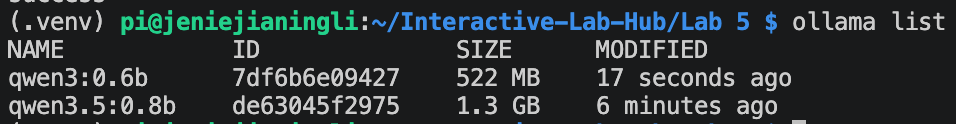

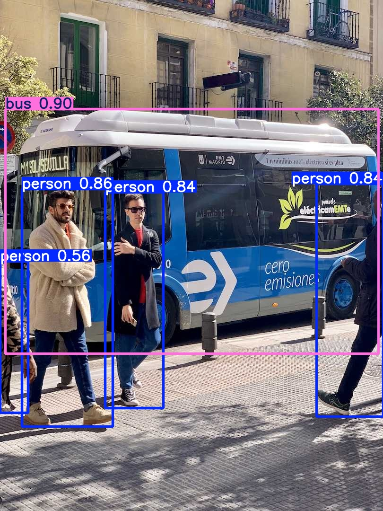

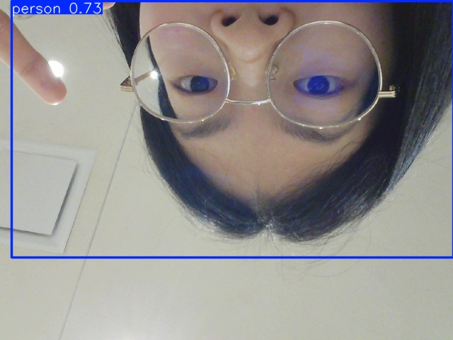

## Part B. 
### See: recognize people in real time with YOLO

\*\*\***Include a short video or screenshots of the person detection. Write down three situations where it did not see you, or saw a person who was not there, and what you think the cause was.**\*\*\*

#### Person Detection Tests

I tested YOLO under different poses, distances, and framing conditions. It was surprisingly robust in some challenging cases:

| Test | Result | Example |
|---|---|---|
| Back facing the camera at a distance | Person detected with **0.87 confidence** | 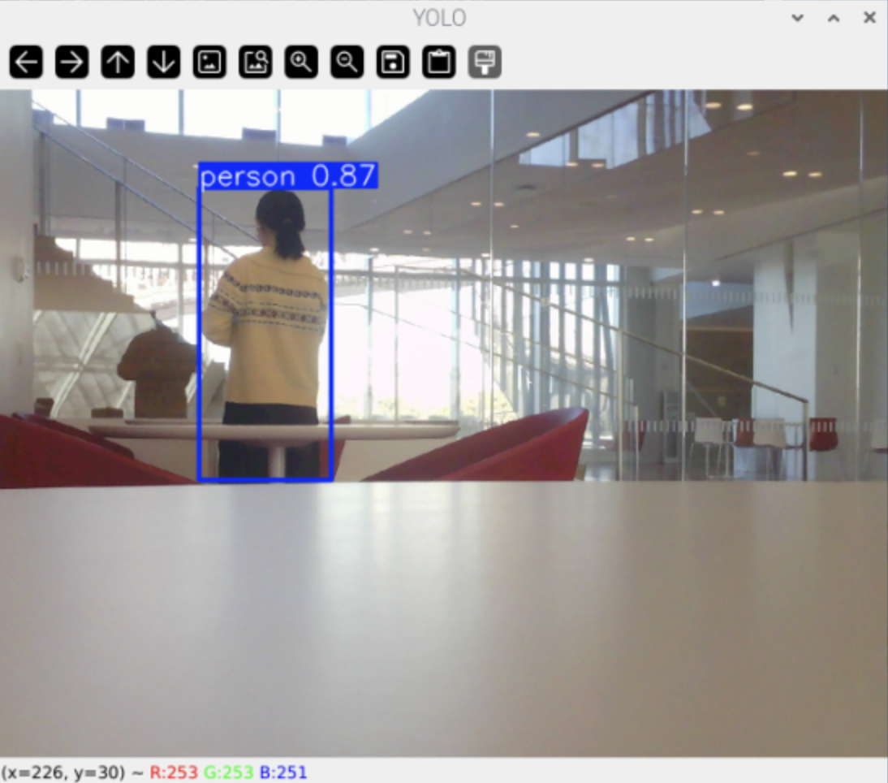 |
| Only part of my hand/body visible | Person detected with **0.71 confidence** | 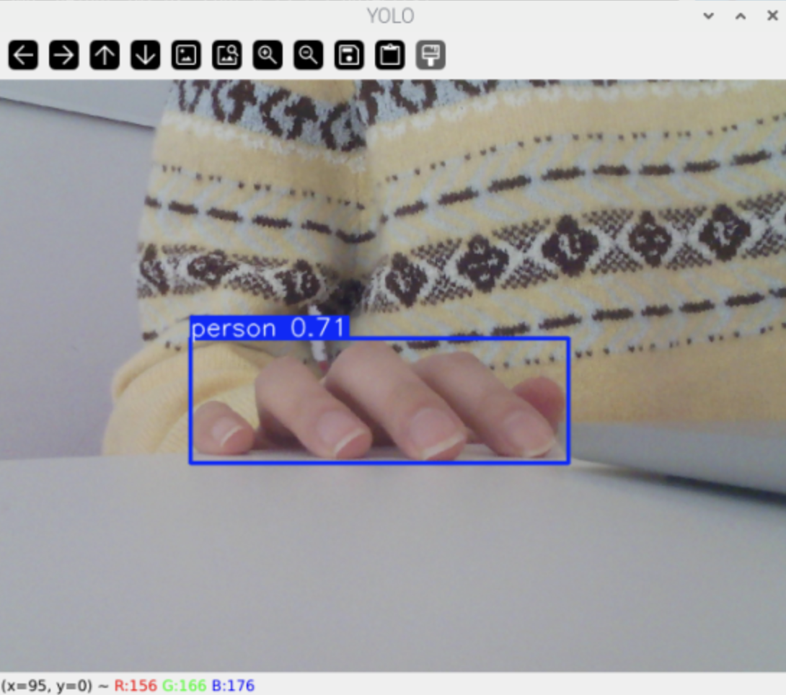 |
| Only a small part of my face and upper body visible | Person detected with **0.46 confidence** | 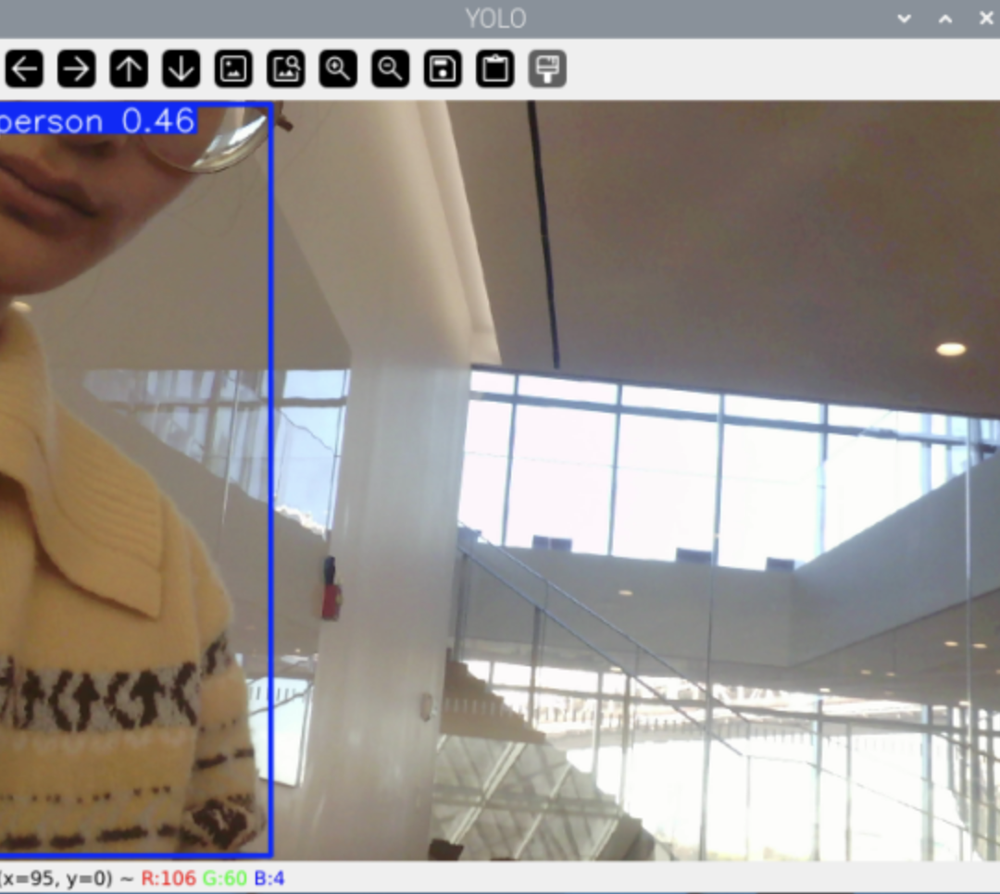 |


#### Failure Cases

I also found several cases where the detector missed a person or produced an incorrect detection:

| Situation | Observation | Possible Cause | Example |
|---|---|---|---|
| **Partially outside the frame** | When I faced away from the camera with about half of my body outside the frame, YOLO did not detect a person. | The model had too little information about the overall human body shape, especially with both an unusual orientation and partial occlusion. | 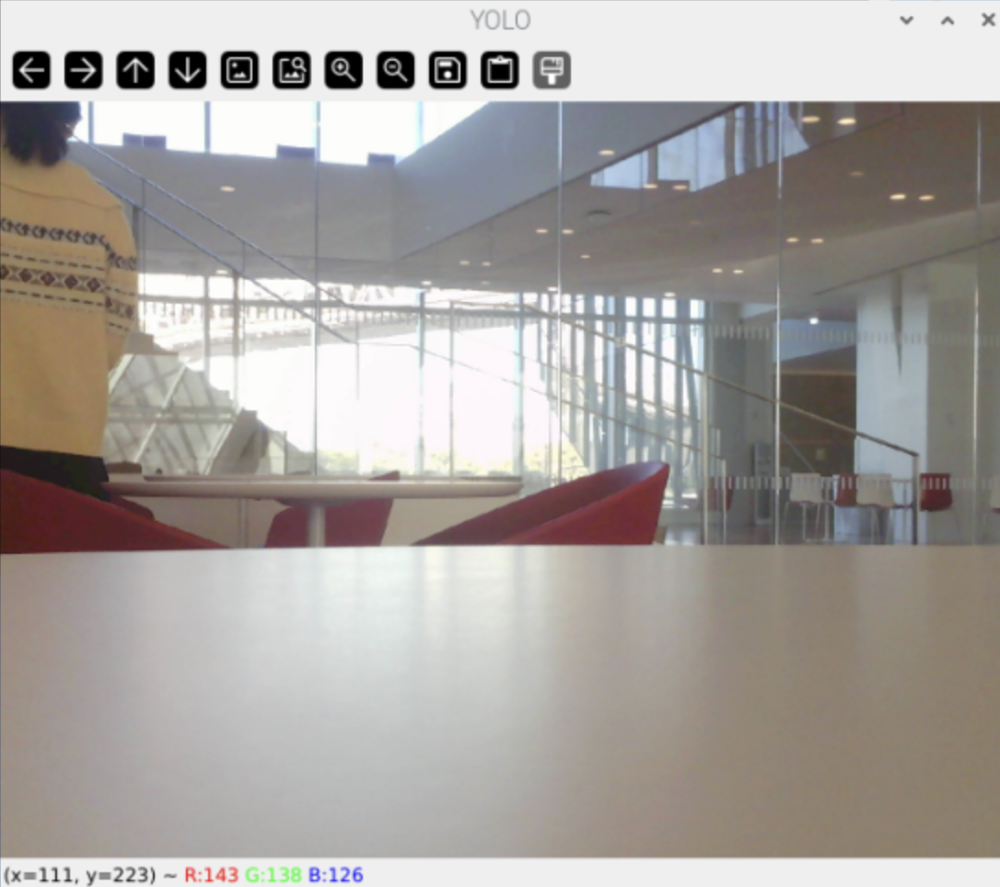 |
| **Shadow on a glass door** | YOLO detected both me and my shadow reflected on the glass door as separate people. | The shadow preserved enough human-like visual features and silhouette for YOLO to classify it as another person. | 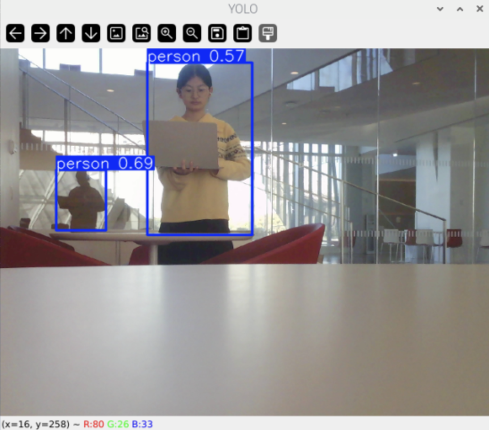 |
| **Person shown on a phone** | A person displayed in a photo on my phone was detected as a person. | YOLO recognizes visual patterns associated with people but does not determine whether the detected person is physically present or shown in an image. | 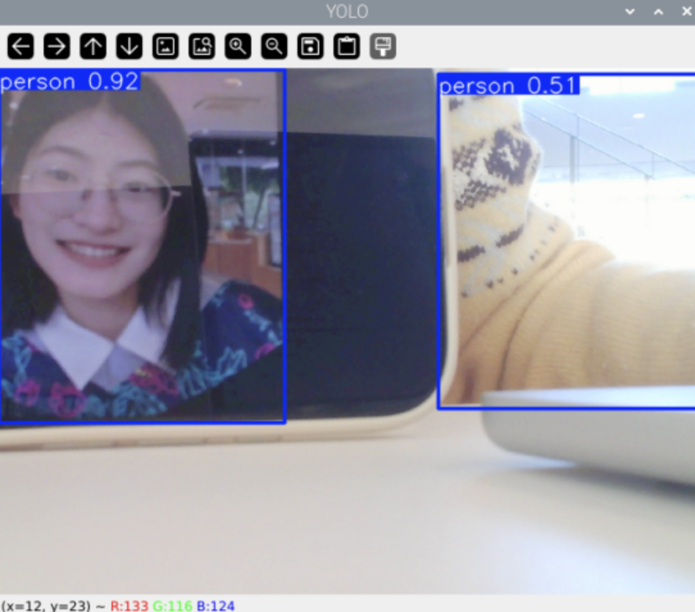 |
| **Partial or less common objects** | Part of my laptop was detected as a **remote**, while the power bank in my hand was detected as a **cell phone**. | Partial views provide fewer visual features for classification, and objects with similar shapes or less typical appearances can be confused with more familiar categories. | 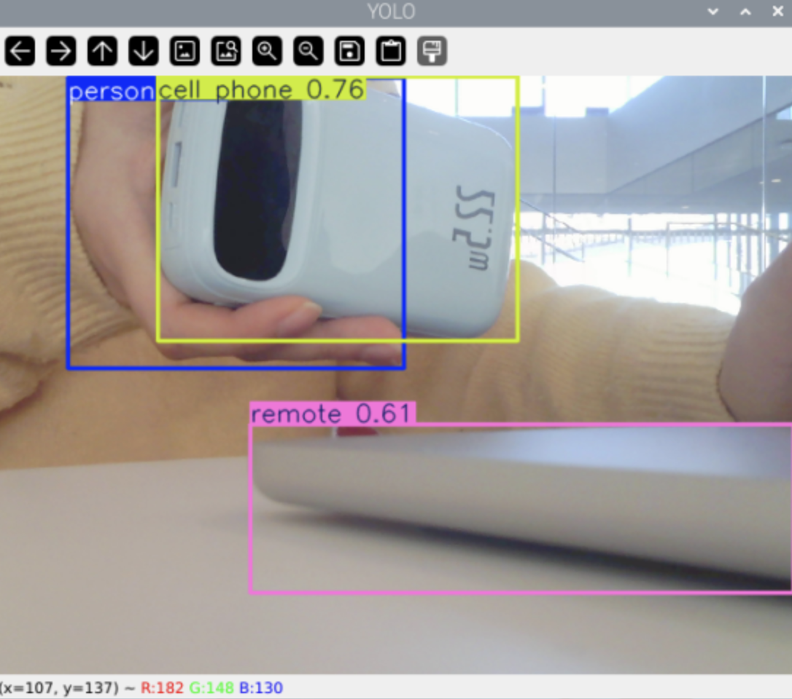 |


## Part C. 
### See more: hands and pose with MediaPipe

\*\*\***Include a screenshot or short video of the hand pose demo, and write how you might use face, hand or body pose tracking in your observant system.**\*\*\*

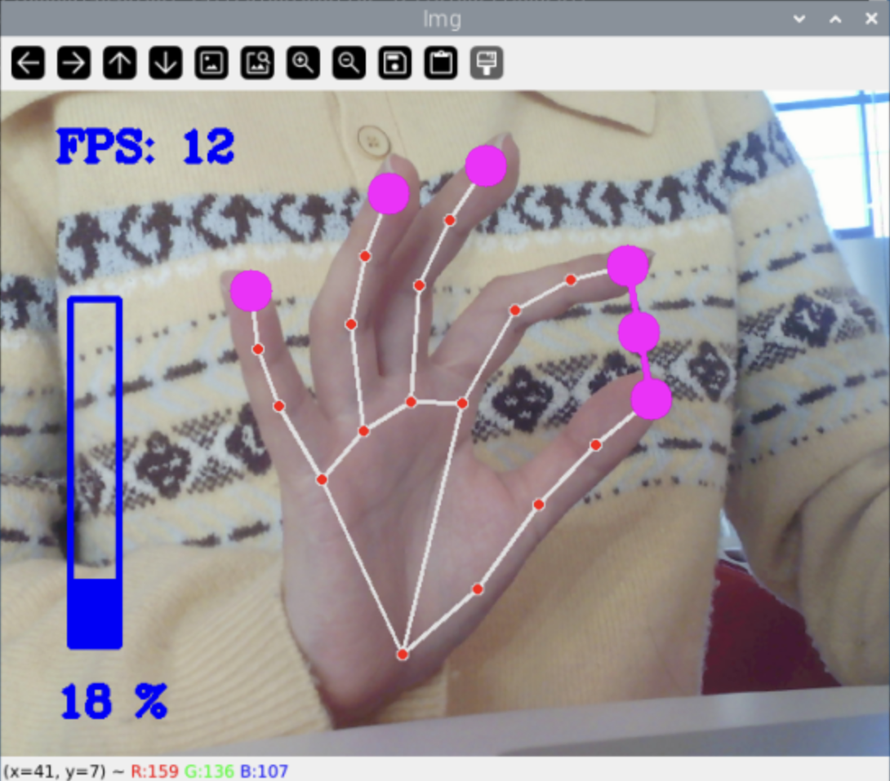

#### Idea for Interaction
I could use hand pose tracking as a simple way to control a night-time observant system without touching the device. For example, a Quiet Coyote gesture before bed could start the overnight monitoring process, while a wave in the morning could stop monitoring and trigger the system to present its summary of the night.


## Part D. 
### Reason: run Qwen on the Pi with Ollama

\*\*\***Ask Qwen three questions a bedside device might need to answer. Paste the questions, the answers and how long each took. Try one of them with `qwen3:0.6b` and compare.**\*\*\*

#### Bedside Device Questions

I tested `qwen3.5:0.8b` with three questions that an overnight bedside device might need to answer.

| Question | Qwen Response | Time |
|---|---|---:|
| **1.** A bedside camera detected a person at 11:30 PM, nobody from midnight to 7 AM, and a person again at 7:10 AM. What probably happened? | “The person likely went to sleep around 11:30 PM and woke up again shortly after 7:10 AM.” | **3.5 s** |
| **2.** A bedside camera detected a person for five seconds at 3 AM and then nobody again. Should the user be worried? Answer cautiously. | “No, you should not be worried. A single detection lasting just five seconds is highly unlikely to indicate an emergency or dangerous situation.” | **4.0 s** |
| **3.** A bedside camera detected no people and no unusual activity from midnight to 7 AM. Write a one-sentence morning summary for the user. | “The system confirmed that no people or unusual activity were detected during the night hours, ensuring a safe sleep environment.” | **4.0 s** |

#### Comparing `qwen3.5:0.8b` and `qwen3:0.6b`

I asked Question 2 again with both models.

| Model | Response | Time |
|---|---|---:|
| `qwen3.5:0.8b` | “Yes, it is prudent to check if the person has been asleep or moved since that time, as this could indicate they are not currently awake.” | **4.8 s** |
| `qwen3:0.6b` | “The user should not be overly concerned, as the camera's detection was brief and the person was not observed again. The device's purpose is to detect people, not to monitor or alarm. The result is a short period of observation, which is typically not a cause for worry.” | **2.7 s** |

In this test, the smaller `qwen3:0.6b` model responded faster and gave a more cautious interpretation. More importantly, `qwen3.5:0.8b` gave **different conclusions when asked the same question twice**: it first said there was no reason to worry, but on the second run suggested checking on the person. This shows that the model's interpretation is not fully consistent and that an observant system should avoid relying on the language model alone for safety-critical judgments.


## Part E. 
### Connect: from YOLO readings to Qwen reasoning

\*\*\***Document the pipeline: at least three runs with the log, the question, Qwen's answer, and whether it was right. Include one case where Qwen got it wrong, and say what you changed in the interpreter and why.**\*\*\*

### Pipeline Tests

The pipeline converts camera observations into text before passing them to Qwen:

**Camera → YOLO → `interpret()` → text log → Qwen**

I ran the pipeline three times with different questions and movements.

#### Run 1 — General Observation

**Question:**  
> How many people were there, what were they doing, and did anything change?

**Log:**
```text
17:26:30 nobody
17:27:06 1 person(s) at left/close
17:27:12 1 person(s) at center/close
17:27:12 1 person(s) at left/close
17:27:13 1 person(s) at center/close
17:27:16 1 person(s) at right/close
17:27:18 nobody
17:27:28 1 person(s) at center/close
```

**Qwen's answer:**  
> There was only one person present throughout the entire 60-second period, located primarily at the center and occasionally near the left or right sides of the room. No activity changed during this time; everyone remained stationary in their positions.

**Was it right?**  
**Partially.** Qwen correctly recognized that at most one person was detected, but incorrectly said that the person was present throughout the entire period and remained stationary. The log begins with `nobody`, contains another `nobody` reading at 17:27:18, and shows the detected position changing between left, center, and right.

---

#### Run 2 — Did Anyone Leave?

**Question:**  
> Did anyone leave?

**Log:**
```text
17:28:12 1 person(s) at center/far
17:28:42 1 person(s) at center/close
17:28:42 1 person(s) at left/close
17:28:43 nobody
17:28:44 1 person(s) at left/close
17:28:45 1 person(s) at right/close
17:28:46 nobody
17:28:54 1 person(s) at right/close
17:28:54 1 person(s) at center/close
17:28:55 1 person(s) at left/close
17:28:59 nobody
```

**Qwen's answer:**  
> Yes, someone left because a line was written only when the reading changed. The log shows that while there were people present at various times (center/close, left/close, right/close), no entry appears for "nobody" after 17:28:43, indicating an absence of occupants during that period.

**Was it right?**  
**The conclusion was right, but the explanation was not fully accurate.** I did leave the camera's view during this run, and the log ends with `nobody`. However, Qwen incorrectly claimed that there was no `nobody` entry after 17:28:43, even though there are `nobody` readings at 17:28:46 and 17:28:59.

---

#### Run 3 — Failure Case

**Question:**  
> Did anyone leave the room and come back?

**Relevant log excerpt:**
```text
17:33:19 1 person(s) at center/close
17:33:20 1 person(s) at left/close
17:33:21 nobody
17:33:27 1 person(s) at left/close
17:33:29 nobody
17:33:30 1 person(s) at left/close
17:33:31 2 person(s) at left/close, center/close
...
17:33:51 nobody
17:33:52 1 person(s) at left/far
17:33:53 nobody
17:33:54 1 person(s) at left/close
```

**Qwen's answer:**  
> Yes, there were people who left the room and came back. The log shows that at 17:33:20, a person was recorded at "left/close," but immediately after (at 17:33:21) it changed to "nobody." Later, at 17:33:31, two people were seen again at "left/close" and "center/close," indicating they had returned.

**Was it right?**  
**No.** I intentionally stayed in the scene and changed my pose and position without actually leaving the room. YOLO repeatedly lost track of me and temporarily reported `nobody`; it also occasionally detected two people even though only one person was present. Qwen treated these detector readings as reliable observations and therefore incorrectly concluded that people had left and returned.

### Interpreter Modification

The original interpreter reduced every detected person to only a position (`left`, `center`, or `right`) and estimated distance (`close` or `far`). I modified it to also preserve YOLO's detection confidence:

```python
conf = float(box.conf)
people.append(f"{side}/{dist} (confidence {conf:.2f})")
```

For example, instead of:

```text
1 person(s) at left/far
```

the interpreter can now output:

```text
1 person(s) at left/far (confidence 0.48)
```

I made this change because my earlier YOLO tests showed that partial bodies and unusual views could produce weaker or unstable detections. Since Qwen never sees the original camera image, preserving confidence gives the reasoner more information about the uncertainty of each detection.

This does not completely solve temporary missed detections: if YOLO detects no person at all, the interpreter still outputs `nobody`. A more robust future version could use temporal smoothing and require several consecutive `nobody` readings before concluding that a person actually left.


---

# Lab 5 Part 2: Overnight Sensation

For Part 2, you will use the observant system from Part 1 to design a night-time interaction. On-device AI is slow, so let it work while you sleep. The person meets the device twice: **before bed**, when they hand the night over, and **when awake**, when the device gives something back. In between, the pipeline from Part E runs on its own.

Two flavors, pick one or mix them:

* **Sense all night.** The Pi watches, listens or measures from bedtime until morning and keeps a log.
* **Process all night.** You already have the data (a day of phone photos, a long recording) and the Pi needs hours to get through it.

Two house rules. Sample rather than stream: one look every 5 to 30 seconds is plenty, and it keeps the Pi cool. And keep everything on the Pi: tell the people you live with, point the camera at things rather than at beds, and delete the snapshots after the demo.

## Part F. 
### Read Part 2 and storyboard your night-time interaction

\*\*\***Insert ideas, sketches, Verplank diagrams and storyboards for your night-time interaction here.**\*\*\*

**Initial Concept: Phone Sleep Check-in**

My night-time interaction is designed to help users reflect on whether they pick up their phone again after deciding to go to sleep. Instead of continuously recording the user, the system treats a designated phone dock as a place where the user intentionally leaves their phone for the night.

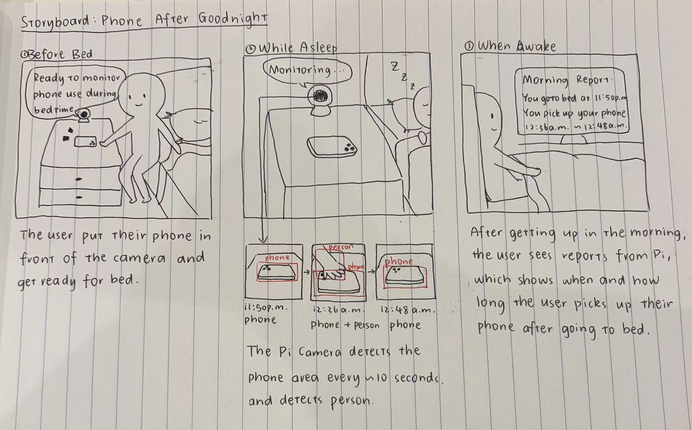

1. Before bed — Handing over the phone.

When the user decides to sleep, they place their phone in a designated phone dock in front of the camera. Once the camera detects the phone in the dock, the system interprets this as the user's intention to stop using their phone and begins the night-time interaction.


2. During the night — Monitoring phone presence.

The camera periodically samples the phone dock. If the phone disappears from the dock, the system records the beginning of a possible phone-use period. When the phone is detected in the dock again, the system records the end of that period.


3. In the morning — Reviewing the night.

When the user wakes up, they make an OK/three-finger gesture toward the camera to end monitoring. The system then summarizes the night, including when the phone was initially put away, when it may have been picked up and returned, and when the user ended the sleep period. These events are presented as a timeline of the night.

The goal is not to determine exactly what the user did on their phone, but to make the gap between “I decided to stop using my phone” and their actual overnight phone behavior visible the next morning.


## Prep for Part 2

1. Look at and give feedback on the Part F storyboards.
   **Put the feedback for your ideas here.**

    - Sampling could miss the exact moment when the phone is picked up. Because the camera only samples approximately every 10 seconds, the user could remove the phone between two observations.
    
    - The start of monitoring could be misinterpreted. The user's hand or body will naturally appear when they first place the phone in the dock, so immediately treating a person detection as overnight activity could create a false event.
    
    - The system needs clearer feedback. The initial storyboard did not clearly communicate when monitoring had successfully started or ended.
    
    - The physical placement of the phone could feel more intentional. A dedicated object for leaving the phone could turn the interaction into a stronger bedtime ritual rather than simply placing a phone in front of a camera.

2. [Update your Lab Hub](prep.md#get-the-latest-content) to get the latest content for Part 2.
3. Decide where the device will spend the night and who else lives there. Get their OK before the first run.
4. Revise your storyboard with the feedback and with what you learned in Part E about where the pipeline breaks.

\*\*\***Post your revised storyboard here.**\*\*\*

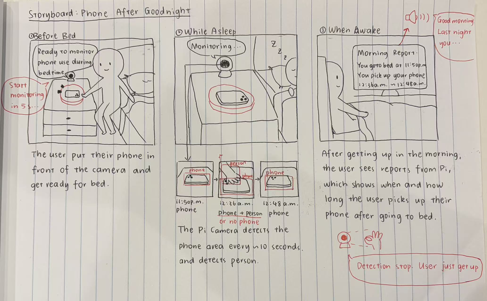

(1) Phone presence becomes the primary signal: Instead of relying on a person detection to determine whether the user is using their phone, the system primarily tracks whether the phone remains in its designated dock. Once the phone has been detected and monitoring has started:

  - Phone present: the phone is considered checked in.
  - Phone disappears: begin a possible phone-use period.
  - Phone appears again: end that period and record it as a possible phone-use event.
  - Phone remains absent: continue the same possible phone-use period rather than creating a new event.

This makes the interaction more robust to the 10-second sampling interval. The system does not need to capture the exact frame in which the user picks up the phone; it can infer that the phone was removed when it is absent from subsequent samples.

Because object detection is imperfect, the system describes these periods as possible phone use rather than claiming that the user was definitely using the phone.

(2) Add a five-second grace period

When the user first places the phone in the dock, their hand or body will naturally appear in the camera view. To avoid interpreting this setup action as overnight activity, the system waits five seconds after the initial phone detection before beginning the actual monitoring period.

The interaction therefore becomes:

Phone detected → 5-second grace period → overnight monitoring begins.

(3) Add spoken acknowledgement

I added audio feedback so that the user knows when the system changes state.

After the phone is placed in the dock and detected, the device says:

“Your sleep check starts in five seconds. I’ll keep an eye on whether your phone stays put tonight. Good night!”

In the morning, after the user performs the ending gesture, the device gives a spoken summary such as:

“Good morning! You checked in your phone at 11:48 PM and ended your night at 7:32 AM. I noticed possible phone use from 12:36 to 12:48 AM and from 1:17 to 1:24 AM.”

The morning report can also present these events visually as a timeline, making it easy to see which portions of the intended sleep period contained possible phone use.

(4) Create a physical “phone check-in” dock

Instead of placing the phone arbitrarily in front of the camera, I plan to create a dedicated physical dock that gives the interaction a stronger sense of ritual. Putting the phone into this object represents deliberately checking the phone in for the night, while removing it represents breaking that commitment.

This physical interaction connects the user's intention (“I am done with my phone”) with a visible action that the observant system can detect.

Revised Interaction Flow

Phone placed in dock
→ phone detected
→ spoken acknowledgement
→ 5-second grace period
→ overnight monitoring
→ phone disappears
→ possible phone-use period begins
→ phone returns
→ possible phone-use period ends
→ morning gesture
→ monitoring ends
→ spoken summary + overnight phone-use timeline


## Part G. 
### Design the interaction before bed

The hand-off: the person tells the device what to watch tonight, and the device acknowledges it. Keep it to a thirty-second ritual. A button or a touch (Lab 4), a spoken sentence (Lab 3), a wave or a Quiet Coyote at the camera (Part C). The acknowledgement can be a line on the display, a tone, or an LED that dims rather than lights up. At its simplest, the hand-off just sets the question that the morning will answer.

\*\*\***Describe the bedtime interaction and include a short video of someone handing the night over to the device.**\*\*\*

## Part H. 
### Incorporate the observant system during sleep

The Part E pipeline becomes the night shift. `overnight.py` runs your `interpret()` from `yolo_to_qwen.py` every few seconds, people only unless you pass `--all`, and writes the readings to `night_log.jsonl`; the reasoning waits for the morning. Start it inside `tmux` so it keeps running after you close your laptop, and stop it with Ctrl-C in the morning:

```
(.venv) pi@raspberrypi:~/Interactive-Lab-Hub/Lab 5 $ tmux new -s night
(.venv) pi@raspberrypi:~/Interactive-Lab-Hub/Lab 5 $ python overnight.py
```

Fake a night first: run it for thirty seconds while you walk around, stop it, and run `morning.py` from Part I. When that looks right, run a real night. If your storyboard needs a sensor rather than the camera, swap in the Lab 4 example code and log its reading the same way.

\*\*\***Run the system for at least one real night. Include the log (or an excerpt) and a few sentences on what broke or surprised you.**\*\*\*

## Part I. 
### Design the interaction when awake

The reveal. The night produced a log; the morning turns it into something a half-awake person can take in. `morning.py` is the smallest version: it asks Qwen for a three-sentence report.

```
(.venv) pi@raspberrypi:~/Interactive-Lab-Hub/Lab 5 $ python morning.py
```

Make it yours: show the report on the Mini PiTFT, read it aloud with Piper from Lab 3, plot the night as a timeline, or ask for JSON (`--json`, Part D) and move a servo. Whatever you pick, make sure it is honest about a night in which nothing happened.

## Final documentation

Document all the prototypes and iterations you have designed and worked on. The deliverables for this lab are writings, sketches, photos, and videos that show what your system:

* "Looks like": how the device sits in the room at night, and what it looks like at bedtime and in the morning.
* "Works like": the pipeline from detector to interpreter to log to reasoner, with a real night's data.
* "Acts like": how a person hands the night over and what they get back.

\*\*\***Include a short video of the whole system: the bedtime hand-off, a log excerpt or timelapse of the night, and the morning reveal from a real overnight run.**\*\*\*

As always, make sure you document contributions and ideas from others (and AI) explicitly in your writeup.

You are permitted (but not required) to work in groups and share a turn in; you are expected to make equal contribution on any group work you do, and N people's group project should look like N times the work of a single person's lab. Make sure the page for the group turn in is linked to your personal Interactive Lab Hub page.

## Deliverables & Submission for Lab 5

For submission, the readme.md page for this lab should be edited to include the work you have done:
* Upload any materials that explain what you did, including your code and night log, into your Lab 5 repository, and link them in your Lab 5 readme.md.
* Link your Lab 5 readme.md in your main Interactive-Lab-Hub readme.md.
* Labs are due on Mondays, make sure to submit your Lab 5 readme.md to Canvas.

<details>
  <summary><strong>Submission Cleanup Reminder (Click to Expand)</strong></summary>

  **Before submitting your README.md:**
  - This readme.md file has a lot of extra text for guidance.
  - Remove all instructional text and example prompts from this file.
  - You may either delete these sections or use the toggle/hide feature in VS Code to collapse them for a cleaner look.
  - Your final submission should be neat, focused on your own work, and easy to read for grading.
</details>
