# Observant Systems: Overnight Sensation

**Team:** Individual submission

**Members:** Jianing Li (jl4837, [jianingli189](https://github.com/jianingli189))

**Project name:** Phone Sleep Check-in

## Contributions and acknowledgements

Regina Chang and Lamiah Khan provided feedback on the storyboard and interaction design. ChatGPT/Codex assisted with code debugging, the Qwiic button implementation, and documentation editing. The project builds on the course's YOLO, Qwen, MediaPipe, and Lab 4 Qwiic examples.

## Project overview

Phone Sleep Check-in uses a Qwiic button to mark the beginning and end of an observation session. YOLO checks whether a phone remains visible in a designated Phone Bed; a deterministic report summarizes observed possible-use intervals. The submitted test is a compressed demonstration, not a real overnight recording.

# Part 1: Tools and experiments

## Part A. 
### Set up your Pi for on-device AI

\*\*\***Include a screenshot of `ollama list` showing your models.**\*\*\*

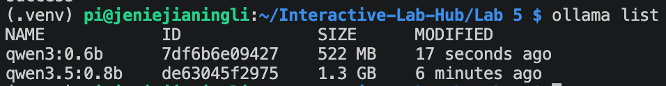


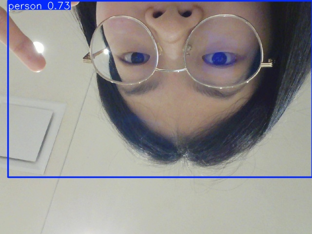

## Part B. 
### See: recognize people in real time with YOLO

\*\*\***Include a short video or screenshots of your experiments with the person detection. Write down three situations where it did not see you, or saw a person who was not there, and what you think the cause was.**\*\*\*

#### Person Detection Tests

I tested YOLO under different poses, distances, and framing conditions. It was surprisingly robust in some challenging cases:

| Test | Result | Example |
|---|---|---|
| Back facing the camera at a distance | Person detected with **0.87 confidence** | 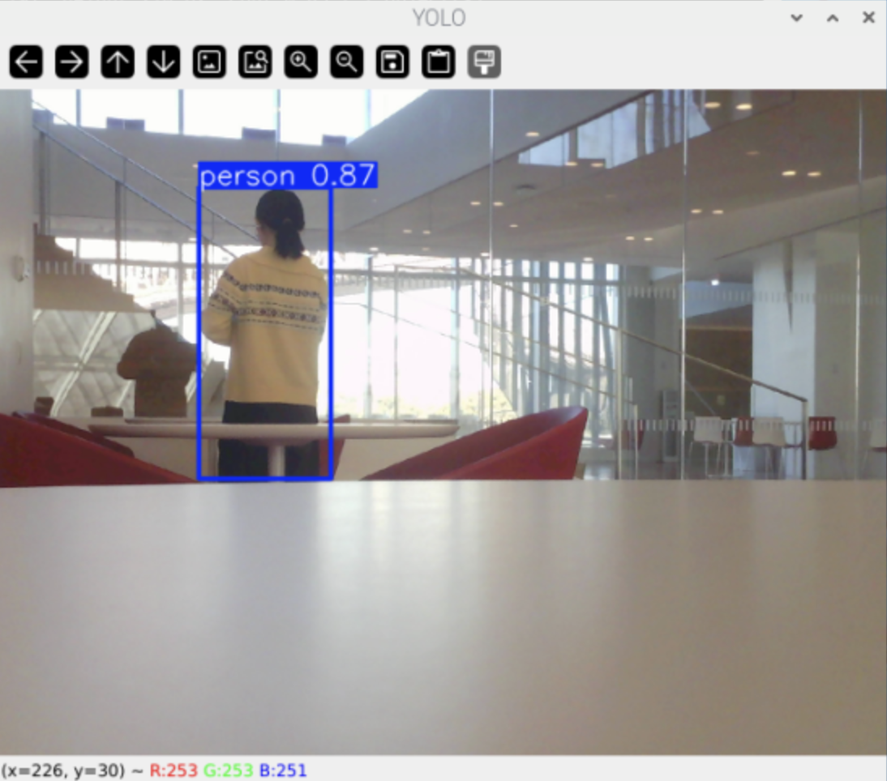 |
| Only part of my hand/body visible | Person detected with **0.71 confidence** | 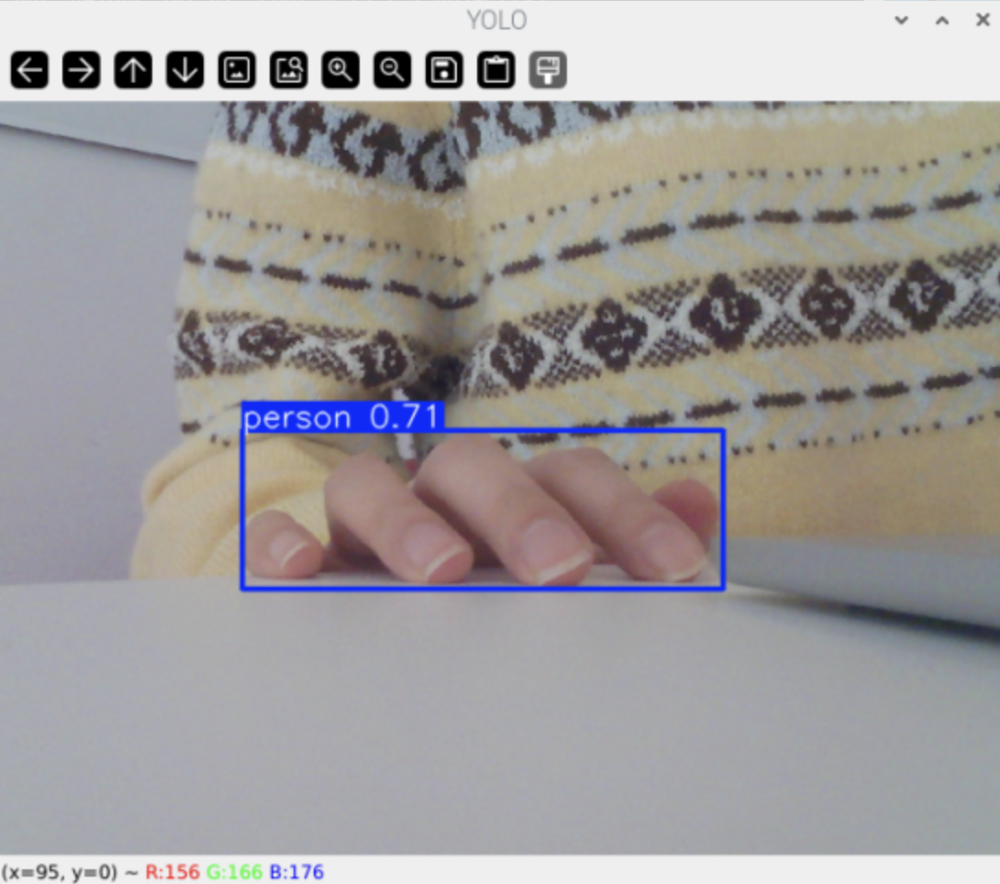 |
| Only a small part of my face and upper body visible | Person detected with **0.46 confidence** | 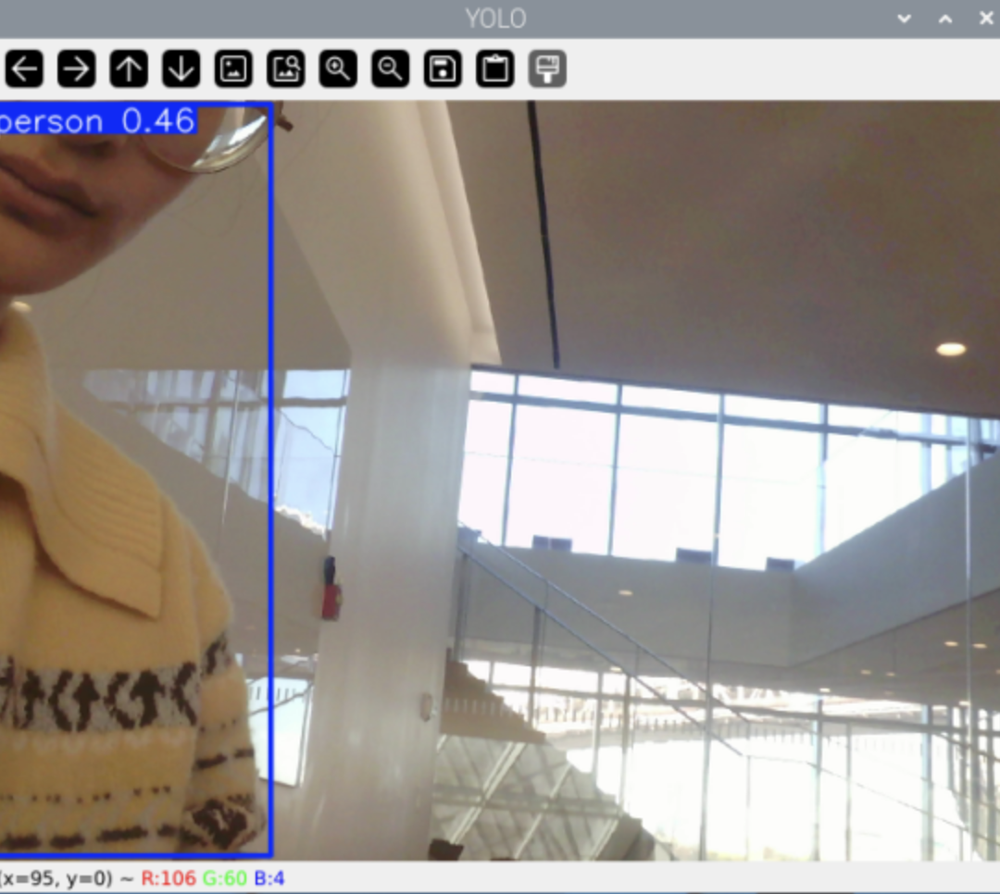 |


#### Failure Cases

I also found several cases where the detector missed a person or produced an incorrect detection:

| Situation | Observation | Possible Cause | Example |
|---|---|---|---|
| **Partially outside the frame** | When I faced away from the camera with about half of my body outside the frame, YOLO did not detect a person. | The model had too little information about the overall human body shape, especially with both an unusual orientation and partial occlusion. | 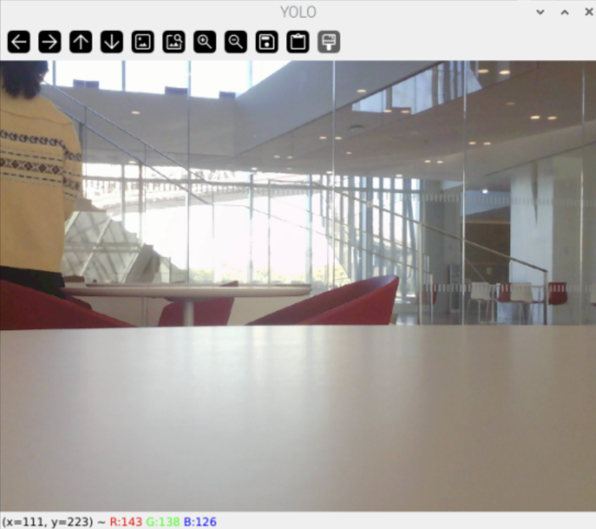 |
| **Shadow on a glass door** | YOLO detected both me and my shadow reflected on the glass door as separate people. | The shadow preserved enough human-like visual features and silhouette for YOLO to classify it as another person. | 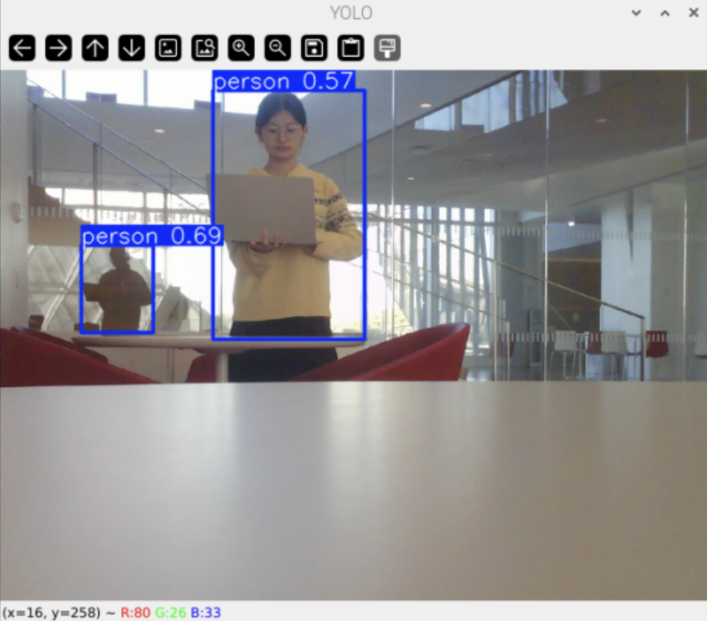 |
| **Person shown on a phone** | A person displayed in a photo on my phone was detected as a person. | YOLO recognizes visual patterns associated with people but does not determine whether the detected person is physically present or shown in an image. | 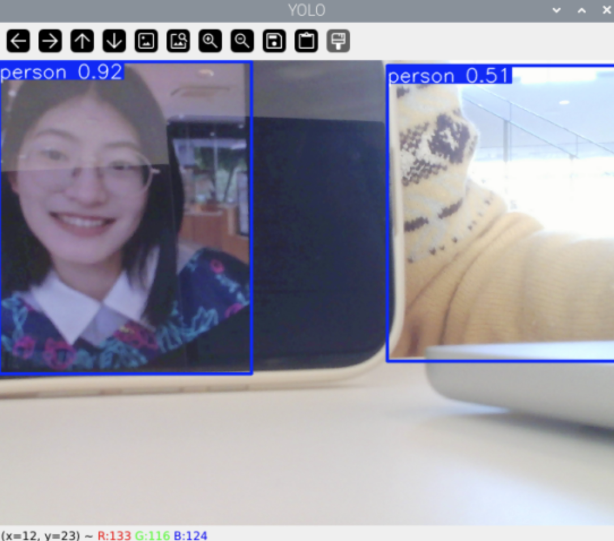 |
| **Partial or less common objects** | Part of my laptop was detected as a **remote**, while the power bank in my hand was detected as a **cell phone**. | Partial views provide fewer visual features for classification, and objects with similar shapes or less typical appearances can be confused with more familiar categories. | 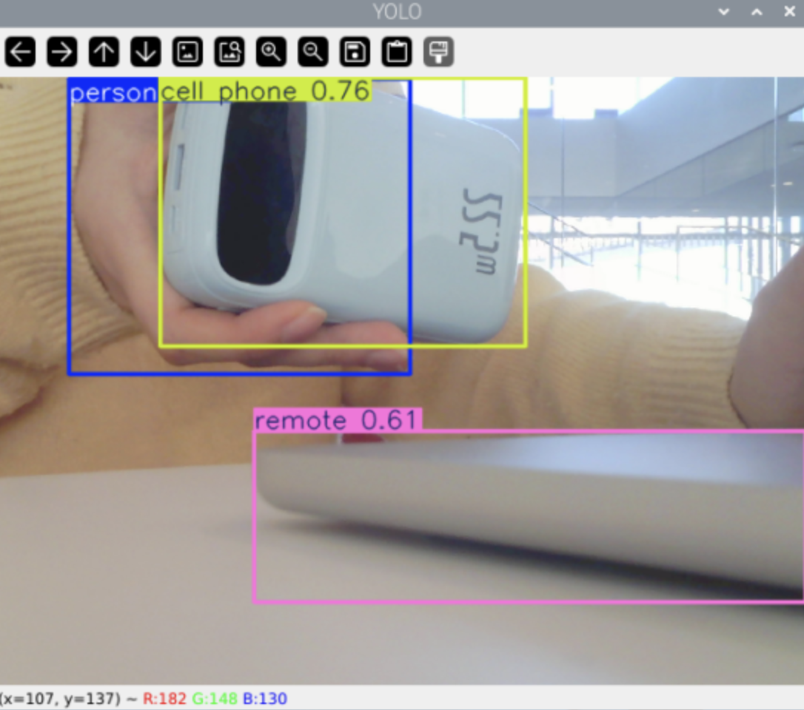 |


## Part C. 
### See more: hands and pose with MediaPipe

\*\*\***Include a screenshot or short video of the hand pose demo, and write how you might use face, hand or body pose tracking in your observant system.**\*\*\*

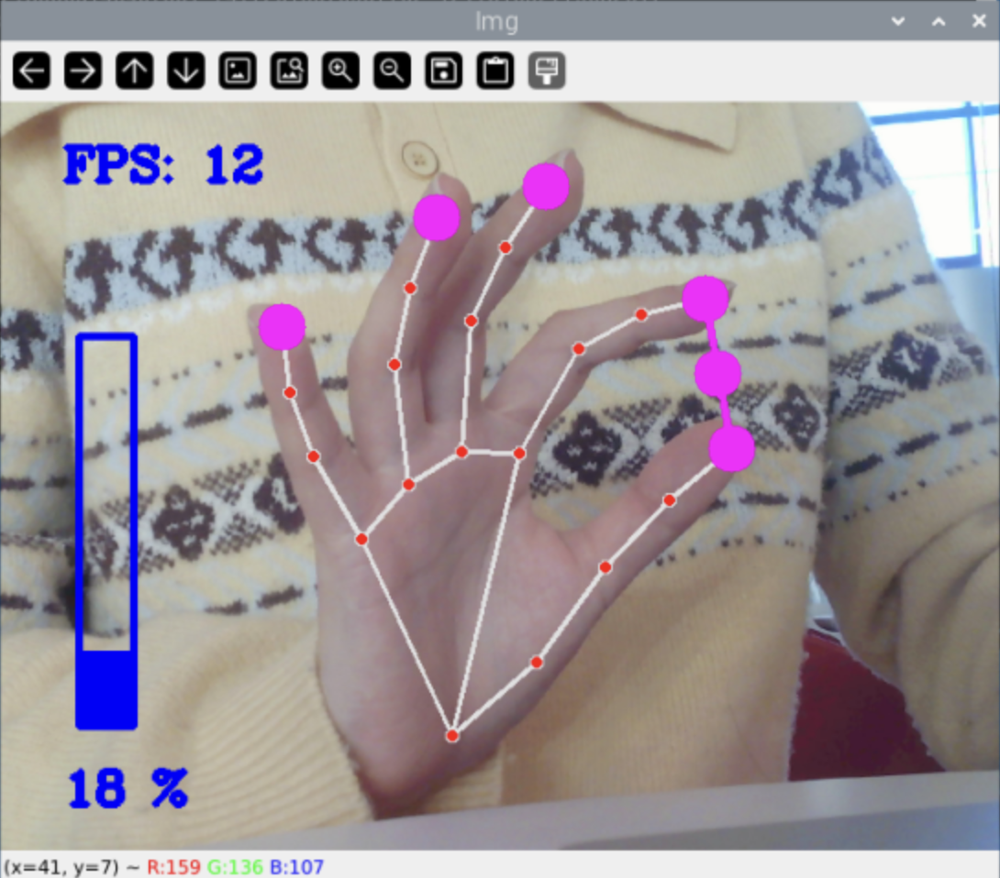

#### Idea for Interaction
I could use hand pose tracking as a simple way to control a night-time observant system without touching the device. For example, a Quiet Coyote gesture before bed could start the overnight monitoring process, while a wave in the morning could stop monitoring and trigger the system to present its summary of the night.


## Part D. 
### Reason: run Qwen on the Pi with Ollama

\*\*\***Ask Qwen three questions to answer. Paste the questions, the answers and how long each took. Try one of them with `qwen3:0.6b` and compare.**\*\*\*

#### Bedside Device Questions

I tested `qwen3.5:0.8b` with three questions that an overnight bedside device might need to answer.

| Question | Qwen Response | Time |
|---|---|---:|
| **1.** A bedside camera detected a person at 11:30 PM, nobody from midnight to 7 AM, and a person again at 7:10 AM. What probably happened? | “The person likely went to sleep around 11:30 PM and woke up again shortly after 7:10 AM.” | **3.5 s** |
| **2.** A bedside camera detected a person for five seconds at 3 AM and then nobody again. Should the user be worried? Answer cautiously. | “No, you should not be worried. A single detection lasting just five seconds is highly unlikely to indicate an emergency or dangerous situation.” | **4.0 s** |
| **3.** A bedside camera detected no people and no unusual activity from midnight to 7 AM. Write a one-sentence morning summary for the user. | “The system confirmed that no people or unusual activity were detected during the night hours, ensuring a safe sleep environment.” | **4.0 s** |

#### Comparing `qwen3.5:0.8b` and `qwen3:0.6b`

I asked Question 2 again with both models.

| Model | Response | Time |
|---|---|---:|
| `qwen3.5:0.8b` | “Yes, it is prudent to check if the person has been asleep or moved since that time, as this could indicate they are not currently awake.” | **4.8 s** |
| `qwen3:0.6b` | “The user should not be overly concerned, as the camera's detection was brief and the person was not observed again. The device's purpose is to detect people, not to monitor or alarm. The result is a short period of observation, which is typically not a cause for worry.” | **2.7 s** |

In this test, the smaller `qwen3:0.6b` model responded faster and gave a more cautious interpretation. More importantly, `qwen3.5:0.8b` gave **different conclusions when asked the same question twice**: it first said there was no reason to worry, but on the second run suggested checking on the person. This shows that the model's interpretation is not fully consistent and that an observant system should avoid relying on the language model alone for safety-critical judgments.


## Part E. 
### Connect: from YOLO readings to Qwen reasoning


### Pipeline Tests

The pipeline converts camera observations into text before passing them to Qwen:

**Camera → YOLO → `interpret()` → text log → Qwen**

I ran the pipeline three times with different questions and movements.

#### Run 1 — General Observation

**Question:**  
> How many people were there, what were they doing, and did anything change?

**Log:**
```text
17:26:30 nobody
17:27:06 1 person(s) at left/close
17:27:12 1 person(s) at center/close
17:27:12 1 person(s) at left/close
17:27:13 1 person(s) at center/close
17:27:16 1 person(s) at right/close
17:27:18 nobody
17:27:28 1 person(s) at center/close
```

**Qwen's answer:**  
> There was only one person present throughout the entire 60-second period, located primarily at the center and occasionally near the left or right sides of the room. No activity changed during this time; everyone remained stationary in their positions.

**Was it right?**  
**Partially.** Qwen correctly recognized that at most one person was detected, but incorrectly said that the person was present throughout the entire period and remained stationary. The log begins with `nobody`, contains another `nobody` reading at 17:27:18, and shows the detected position changing between left, center, and right.

---

#### Run 2 — Did Anyone Leave?

**Question:**  
> Did anyone leave?

**Log:**
```text
17:28:12 1 person(s) at center/far
17:28:42 1 person(s) at center/close
17:28:42 1 person(s) at left/close
17:28:43 nobody
17:28:44 1 person(s) at left/close
17:28:45 1 person(s) at right/close
17:28:46 nobody
17:28:54 1 person(s) at right/close
17:28:54 1 person(s) at center/close
17:28:55 1 person(s) at left/close
17:28:59 nobody
```

**Qwen's answer:**  
> Yes, someone left because a line was written only when the reading changed. The log shows that while there were people present at various times (center/close, left/close, right/close), no entry appears for "nobody" after 17:28:43, indicating an absence of occupants during that period.

**Was it right?**  
**The conclusion was right, but the explanation was not fully accurate.** I did leave the camera's view during this run, and the log ends with `nobody`. However, Qwen incorrectly claimed that there was no `nobody` entry after 17:28:43, even though there are `nobody` readings at 17:28:46 and 17:28:59.

---

#### Run 3 — Failure Case

**Question:**  
> Did anyone leave the room and come back?

**Relevant log excerpt:**
```text
17:33:19 1 person(s) at center/close
17:33:20 1 person(s) at left/close
17:33:21 nobody
17:33:27 1 person(s) at left/close
17:33:29 nobody
17:33:30 1 person(s) at left/close
17:33:31 2 person(s) at left/close, center/close
...
17:33:51 nobody
17:33:52 1 person(s) at left/far
17:33:53 nobody
17:33:54 1 person(s) at left/close
```

**Qwen's answer:**  
> Yes, there were people who left the room and came back. The log shows that at 17:33:20, a person was recorded at "left/close," but immediately after (at 17:33:21) it changed to "nobody." Later, at 17:33:31, two people were seen again at "left/close" and "center/close," indicating they had returned.

**Was it right?**  
**No.** I intentionally stayed in the scene and changed my pose and position without actually leaving the room. YOLO repeatedly lost track of me and temporarily reported `nobody`; it also occasionally detected two people even though only one person was present. Qwen treated these detector readings as reliable observations and therefore incorrectly concluded that people had left and returned.

### Interpreter Modification

The original interpreter reduced every detected person to only a position (`left`, `center`, or `right`) and estimated distance (`close` or `far`). I modified it to also preserve YOLO's detection confidence:

```python
conf = float(box.conf)
people.append(f"{side}/{dist} (confidence {conf:.2f})")
```

For example, instead of:

```text
1 person(s) at left/far
```

the interpreter can now output:

```text
1 person(s) at left/far (confidence 0.48)
```

I made this change because my earlier YOLO tests showed that partial bodies and unusual views could produce weaker or unstable detections. Since Qwen never sees the original camera image, preserving confidence gives the reasoner more information about the uncertainty of each detection.

This does not completely solve temporary missed detections: if YOLO detects no person at all, the interpreter still outputs `nobody`. A more robust future version could use temporal smoothing and require several consecutive `nobody` readings before concluding that a person actually left.


---

# Part 2: Phone Sleep Check-in

## Part F. 
### Read Part 2 and storyboard your night-time interaction

\*\*\***Insert ideas, sketches, Verplank diagrams and storyboards for your night-time interaction here.**\*\*\*

**Initial Concept: Phone Sleep Check-in**

My night-time interaction is designed to help users reflect on whether they pick up their phone again after deciding to go to sleep. Instead of continuously recording the user, the system treats a designated phone dock as a place where the user intentionally leaves their phone for the night.

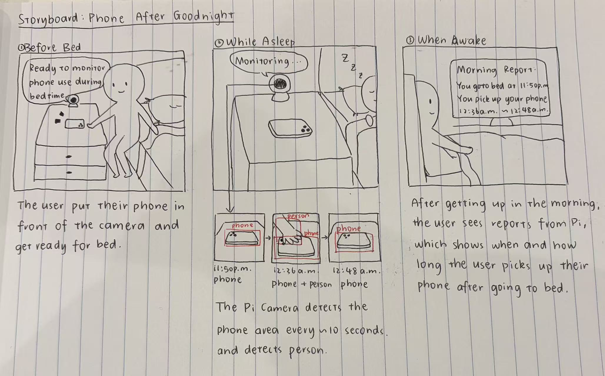

1. Before bed — Handing over the phone.

When the user decides to sleep, they place their phone in a designated phone dock in front of the camera. Once the camera detects the phone in the dock, the system interprets this as the user's intention to stop using their phone and begins the night-time interaction.


2. During the night — Monitoring phone presence.

The camera periodically samples the phone dock. If the phone disappears from the dock, the system records the beginning of a possible phone-use period. When the phone is detected in the dock again, the system records the end of that period.


3. In the morning — Reviewing the night.

When the user wakes up, they make an OK/three-finger gesture toward the camera to end monitoring. The system then summarizes the night, including when the phone was initially put away, when it may have been picked up and returned, and when the user ended the sleep period. These events are presented as a timeline of the night.

The goal is not to determine exactly what the user did on their phone, but to make the gap between “I decided to stop using my phone” and their actual overnight phone behavior visible the next morning.


## Design feedback and revision

**Feedback on the initial storyboard**

   I received feedback from Regina Chang and Lamiah Khan.

    - Sampling could miss the exact moment when the phone is picked up. Because the camera only samples approximately every 10 seconds, the user could remove the phone between two observations.
    
    - The start of monitoring could be misinterpreted. The user's hand or body will naturally appear when they first place the phone in the dock, so immediately treating a person detection as overnight activity could create a false event.
    
    - The system needs clearer feedback. The initial storyboard did not clearly communicate when monitoring had successfully started or ended.
    
    - The physical placement of the phone could feel more intentional. A dedicated object for leaving the phone could turn the interaction into a stronger bedtime ritual rather than simply placing a phone in front of a camera.

\*\*\***Post your revised storyboard here.**\*\*\*

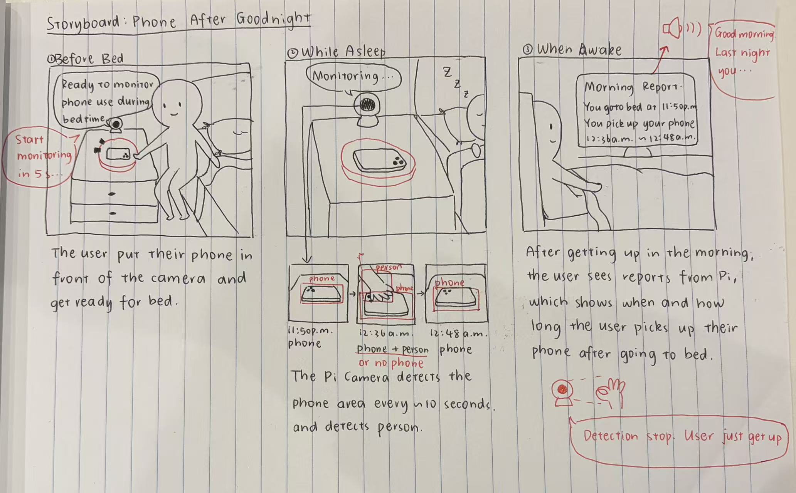

(1) Phone presence becomes the primary signal: Instead of relying on a person detection to determine whether the user is using their phone, the system primarily tracks whether the phone remains in its designated dock. Once the phone has been detected and monitoring has started:

  - Phone present: the phone is considered checked in.
  - Phone disappears: begin a possible phone-use period.
  - Phone appears again: end that period and record it as a possible phone-use event.
  - Phone remains absent: continue the same possible phone-use period rather than creating a new event.

This makes the interaction more robust to the 10-second sampling interval. The system does not need to capture the exact frame in which the user picks up the phone; it can infer that the phone was removed when it is absent from subsequent samples.

Because object detection is imperfect, the system describes these periods as possible phone use rather than claiming that the user was definitely using the phone.

(2) Add a five-second grace period

When the user first places the phone in the dock, their hand or body will naturally appear in the camera view. To avoid interpreting this setup action as overnight activity, the system waits five seconds after the initial phone detection before beginning the actual monitoring period.

The interaction therefore becomes:

Phone detected → 5-second grace period → overnight monitoring begins.

(3) Add spoken acknowledgement

I added audio feedback so that the user knows when the system changes state.

After the phone is placed in the dock and detected, the device says:

“Your sleep check starts in five seconds. I’ll keep an eye on whether your phone stays put tonight. Good night!”

In the morning, after the user performs the ending gesture, the device gives a spoken summary such as:

“Good morning! You checked in your phone at 11:48 PM and ended your night at 7:32 AM. I noticed possible phone use from 12:36 to 12:48 AM and from 1:17 to 1:24 AM.”

The morning report can also present these events visually as a timeline, making it easy to see which portions of the intended sleep period contained possible phone use.

(4) Create a physical “phone check-in” dock

Instead of placing the phone arbitrarily in front of the camera, I plan to create a dedicated physical dock that gives the interaction a stronger sense of ritual. Putting the phone into this object represents deliberately checking the phone in for the night, while removing it represents breaking that commitment.

This physical interaction connects the user's intention (“I am done with my phone”) with a visible action that the observant system can detect.

Revised Interaction Flow

Phone placed in dock
→ phone detected
→ spoken acknowledgement
→ 5-second grace period
→ overnight monitoring
→ phone disappears
→ possible phone-use period begins
→ phone returns
→ possible phone-use period ends
→ morning gesture
→ monitoring ends
→ spoken summary + overnight phone-use timeline


### Final implementation update: Qwiic button boundaries

The storyboards above capture the earlier gesture-based concept: placing the phone in its dock begins the bedtime ritual, and an OK gesture ends the observation period in the morning. Part C helped me explore how hand tracking could support this interaction. During implementation, however, I found that gesture recognition and the system's response felt too slow. The delay made it difficult to tell whether the system had recognized my intention or whether I needed to repeat the gesture. This was especially problematic for ending a session, where the user needs a clear indication that monitoring has stopped and the morning reveal is beginning.

I therefore replaced the ending gesture with a **SparkFun Qwiic button** and used the same button to explicitly arm the bedtime hand-off. This change addresses the feedback about making the start and end of monitoring clearer: the user presses once before placing the phone in the Phone Bed, then presses again to end the session. The button provides a deliberate physical input without depending on successful visual recognition of a hand pose. Phone placement and YOLO detection still complete the check-in, preserving the Phone Bed ritual at the center of the storyboards.

The final implementation separates the user's explicit control input from the camera's observation task. Qwiic button polling runs independently of YOLO inference, while the camera continues to detect phone presence using five-frame temporal voting. This does not eliminate phone-detection latency, but it prevents the start/end input from relying on the slower gesture-recognition interaction. The storyboards and Part C remain as records of the design process; the button-based flow below documents the implemented revision. `my_overnight.py` no longer imports MediaPipe or recognizes an OK gesture.

Final flow: first Qwiic press → place phone in Phone Bed → five-frame phone vote → spoken acknowledgement → five-second grace period → monitoring → second Qwiic press → close intervals and save structured log → deterministic spoken morning report. The earlier gesture and visual timeline are design proposals; the implemented reveal is spoken output plus a JSONL record.

The button uses I2C, following `../Lab 4/qwiic_1_button.py`: `qwiic_button.QwiicButton(address)`, `begin()`, and `is_button_pressed()`. Lab 4's requirements already list `sparkfun-qwiic-button`. The default address is `0x6F`; the two-button example uses `0x6E` for a second button, and the course includes an address-changing example. The supplied Raspberry Pi test transcript confirms successful initialization at `0x6F` and a recorded bedtime button press.

The button connects through a Qwiic cable to the Pi's I2C adapter (3.3 V, GND, SDA, SCL), following the [SparkFun Qwiic Button guide](https://learn.sparkfun.com/tutorials/sparkfun-qwiic-button-hookup-guide/python-package). Button polling runs independently of inference, with press-edge detection and debounce so a held button does not count twice. A second press before monitoring cancels the hand-off.


## Part G. 
### Design the interaction before

\*\*\***Describe the interaction before.**\*\*\*

For the bedtime hand-off, I designed a phone check-in ritual. When I decide to stop using my phone and go to sleep, I first press and release the Qwiic button, then place my phone in a designated position, or “Phone Bed,” in front of the Raspberry Pi camera. Placing the phone in this location communicates my intention to stop using it for the night and tells the system what to watch: whether the checked-in phone remains in its dock.

Once at least two of five valid camera frames detect the phone, it acknowledges the hand-off through the speaker: “Your sleep check starts in five seconds. I’ll keep an eye on whether your phone stays put tonight. Good night!” The system then waits for five seconds before beginning monitoring. I added this grace period based on feedback on my initial storyboard, since my hand and body naturally remain in view while I place the phone down. The delay prevents this transition period from immediately affecting the overnight observations.

The interaction is intentionally short: press the button, then put the phone to “bed.” The button explicitly arms the hand-off; the phone placement completes the bedtime ritual. The five-second grace period begins after the acknowledgement finishes.

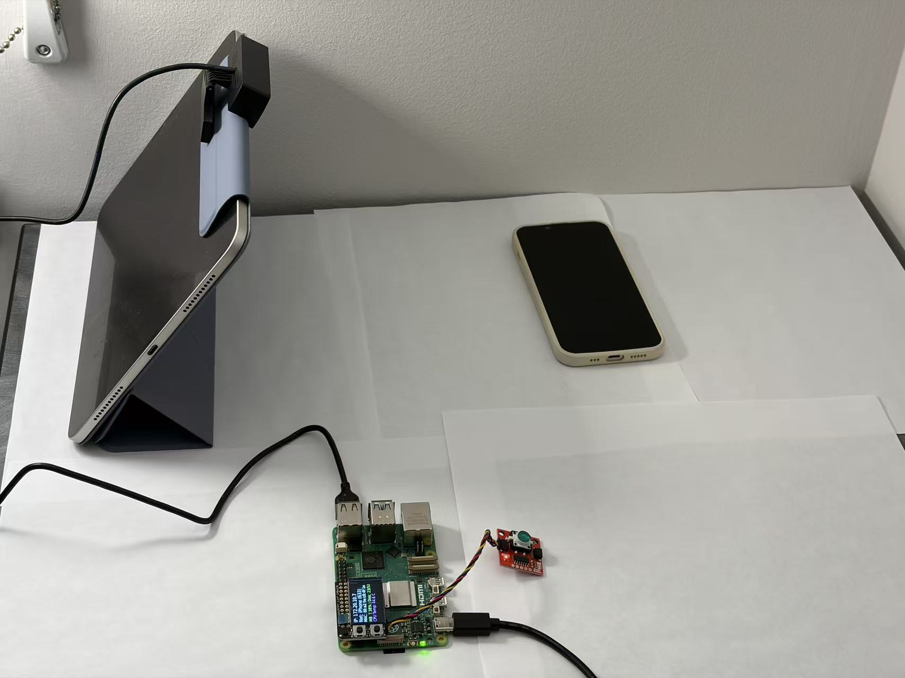

[▶ Watch the Qwiic bedtime hand-off demo](my_video/hand_off.mp4)

The setup photo shows the Raspberry Pi, Qwiic button and connection, camera, and phone placement.


## Part H. 
### Incorporate the observant system

\*\*\***Screenshots or videos of the running system.**\*\*\*

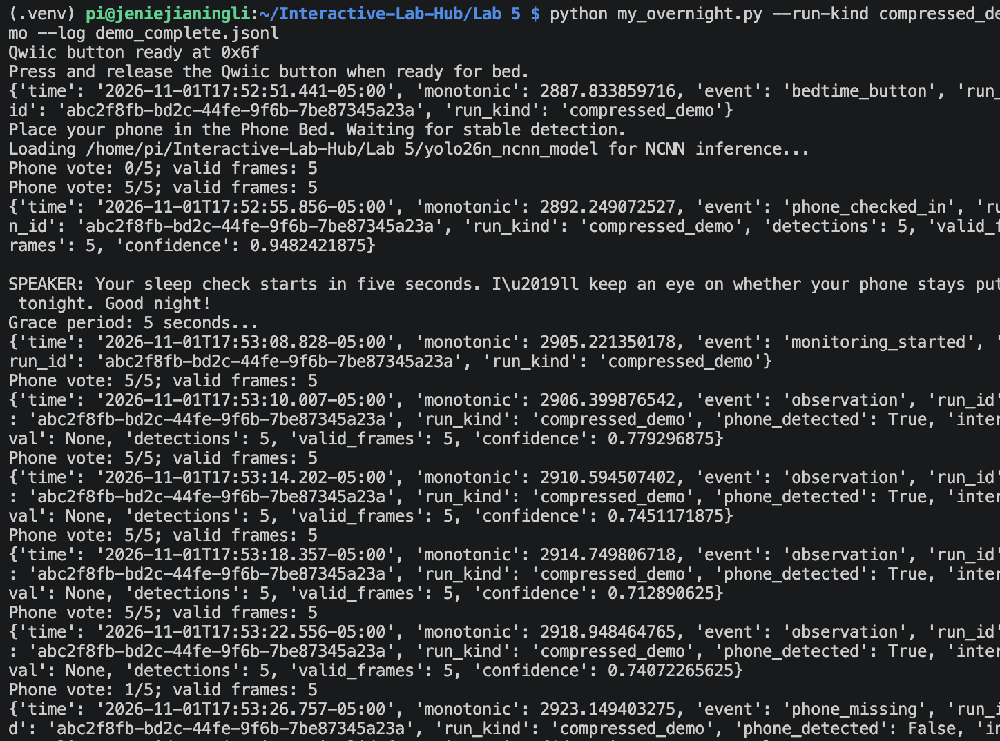

For the overnight observation, I adapted the Part E perception pipeline from person detection to phone-presence monitoring. Rather than continuously recording video, the Raspberry Pi periodically samples the camera and uses YOLO to determine whether the checked-in phone remains visible in its designated dock.

**Monitoring Logic**

I implemented the interaction as a simple state machine:

Phone in dock → Phone disappears → Possible phone use → Phone returns → Phone in dock

When the phone is detected, the system remains in the phone_in_dock state. If the phone is no longer detected, the system begins a possible_phone_use period and records its start time. Repeated missing observations are treated as part of the same period rather than separate events. When the phone appears again, the system records the return time and closes the possible-use period.

I intentionally describe these events as possible phone use, rather than confirmed phone use. The camera can observe whether the phone is visible in its dock, but disappearance alone does not prove that the user was actively using it.

**Improving Detection Reliability**

During initial testing, I found that single-frame YOLO detection was too unstable for overnight monitoring. The phone could remain stationary in the dock while briefly disappearing from the detector's output, which created false phone_missing events.

To make the observation more robust, I changed each observation from a single-frame decision to a five-frame temporal vote. For every sampling point, the system analyzes five consecutive frames. If the phone is detected in at least two of the five frames, the observation is classified as phone present.

This substantially improved the stability of the system. In the fake-night test, the stationary phone was typically detected in 4–5 out of 5 frames, while removing the phone produced 0–1 detections out of 5.

### Completed compressed demonstration — November 1, 2026

I tested the full button-controlled software flow in a compressed/simulated overnight demonstration. This is not a real overnight run. The Qwiic button initialized at `0x6F`; the first press armed phone check-in and the second press ended monitoring and generated the deterministic morning report.

Evidence:

- [Complete terminal transcript](evidence/qwiic_complete_terminal.txt)
- [Structured JSONL converted from the printed events](evidence/demo_complete_from_transcript.jsonl)
- [Exact generated morning report](evidence/morning_report.txt)
- [Evidence provenance](evidence/README.md)
- [Watch the complete compressed demonstration](my_video/overnight_demo.mp4)

Run ID: `abc2f8fb-bd2c-44fe-9f6b-7be87345a23a`. All times below are on November 1, 2026, UTC−05:00.

| Event | Time |
|---|---|
| First Qwiic press | 17:52:51.441 |
| Phone check-in (5/5 frames) | 17:52:55.856 |
| Monitoring begins after acknowledgement and grace period | 17:53:08.828 |
| Second Qwiic press / monitoring ends | 17:54:19.811 |
| Morning report generated | 17:54:19.823 |

Monitoring lasted approximately 70.982 seconds. There was no automatic timer stop.

| Possible-use interval | Observed start | Observed end | Duration | Closure |
|---|---|---|---|---|
| 1 | 17:53:26.757 | 17:53:51.813 | 25.057 seconds | Phone returned |
| 2 | 17:54:00.181 | 17:54:04.347 | 4.166 seconds | Phone returned |

Total observed possible-use duration: **29.223 seconds**. Repeated missing observations continued the first interval instead of creating new events. The second interval is retained exactly as logged; if there was no second physical removal, it represents a false negative rather than confirmed phone use. Without matching the video to the observations, I cannot distinguish those explanations. Durations use the monotonic clock; subtracting millisecond-rounded wall timestamps can differ by 0.001 seconds.

The JSONL linked above preserves every event printed in the supplied transcript. It is explicitly a transcript-derived copy; the original Pi file is not included in this checkout. The terminal verifies report generation and the speech command's printed text, not audible speaker output. Audio playback and video timing require separate verification.

Earlier debugging evidence is retained separately: [interrupted Qwiic test](evidence/qwiic_test_aborted_terminal.txt) and the earlier temporal-voting screenshot below. That earlier test ended with Ctrl-C and is not the completed demonstration.

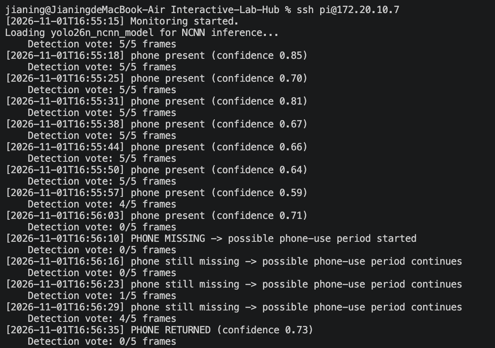

**Evaluation scope**

The submitted evidence demonstrates the full interaction over a compressed session. It does not evaluate detection accuracy over a real night, low-light performance throughout sleep, or long-duration reliability.

**What Broke or Surprised Me**

The initial single-frame implementation produced many false missing-phone events even though the phone had not moved. Temporal voting made the detector substantially more stable, but occasional false negatives can still occur. For example, a brief failed observation may cause the system to temporarily report that the phone is missing before detecting it again.

Another limitation is that the system observes phone presence, not actual phone activity. A missing phone is therefore treated only as evidence of possible phone use. In addition, because the system samples periodically rather than continuously recording video, a very short pickup-and-return interaction could occur between observations and be missed.


**Final implementation and log semantics**

`my_overnight.py` waits for the Qwiic start press before checking in the phone. Each observation retains the five-frame vote (at least 2/5 detections, confidence threshold 0.40, COCO cell-phone class 67). There is a three-second wait between observations, in addition to inference and frame acquisition time; this is not an exact three-second sampling cadence. A failed camera read makes that observation unknown and does not start or close an interval.

The first missing observation opens one interval; later missing observations continue it. A present observation closes it. The morning button closes any still-open interval at the recorded button time and marks it `morning_button`, not `phone_returned`. JSONL includes observations, interval endpoints, durations, end reason, total duration, and the exact report text. Wall timestamps include date and UTC offset; durations use the monotonic clock so clock adjustments do not distort elapsed time. These are exact calculations from observed boundaries, not exact measurements of actual phone activity. Sampling, inference latency, lighting, occlusion, and false detections still limit accuracy; the detector checks the camera view rather than a calibrated dock-only region.

There is no automatic 60-second stop and no Qwen inference of times. Logs append rather than erasing previous runs. Ctrl-C or a hardware error records an aborted session, not a successful morning reveal. The latest supplied Pi transcript verifies button initialization, bedtime input, check-in, grace period, phone-presence transitions, second-button completion, and morning report generation. A terminal transcript alone cannot verify audible speaker output. No real-night run is documented yet.


## Part I. 
### Design the interaction after

In the morning, the user presses the same Qwiic button a second time. Monitoring ends at the recorded press time. The system closes any remaining possible-use interval, writes the summary to JSONL, and uses eSpeak to read a deterministic report containing check-in time, each observed possible-use interval and duration, and the end time. With no intervals, it says that it did not notice possible phone use; it does not claim the user slept or never touched the phone. If the phone is still absent, the report explicitly says so.

In the completed demonstration, the generated report correctly lists two possible-use periods (about 25.1 and 4.2 seconds), check-in at 17:52:55.856, and the second-button end at 17:54:19.811. [Read the exact report text](evidence/morning_report.txt). It reports sampled observations rather than claiming confirmed activity or sleep quality.

`morning.py` and its Qwen prompt belong to the course exploration; the final workflow runs entirely through `my_overnight.py` and does not use Qwen to infer timing or generate facts.

## Final documentation

\*\*\***Include a short video of the whole system**\*\*\*

[▶ Watch the complete compressed demonstration](my_video/overnight_demo.mp4)

[▶ Watch the bedtime hand-off](my_video/hand_off.mp4)

- **Looks like:** The [setup photo](my_image/setup.jpg) shows the camera aimed at the phone placement area, the Raspberry Pi, and the connected Qwiic button.
- **Works like:** Camera → YOLO → five-frame temporal vote → interval state machine → JSONL → deterministic report. Part E documents the earlier YOLO-to-Qwen exploration; the final version computes timing directly from recorded events to avoid invented durations.
- **Acts like:** The first button press arms phone check-in; the second ends monitoring and generates the morning reveal. The [original](my_image/storyboard.jpg) and [revised storyboard](my_image/storyboard_revised.jpg) document the earlier gesture concept, followed by the implemented Qwiic boundary.