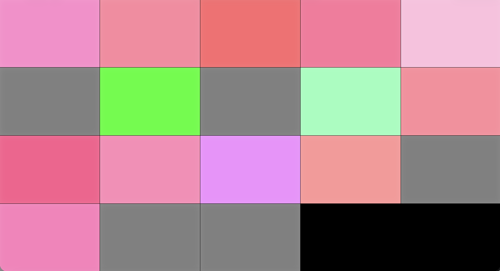
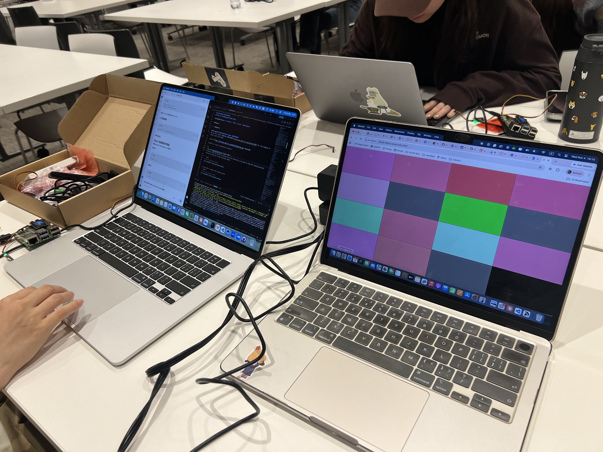
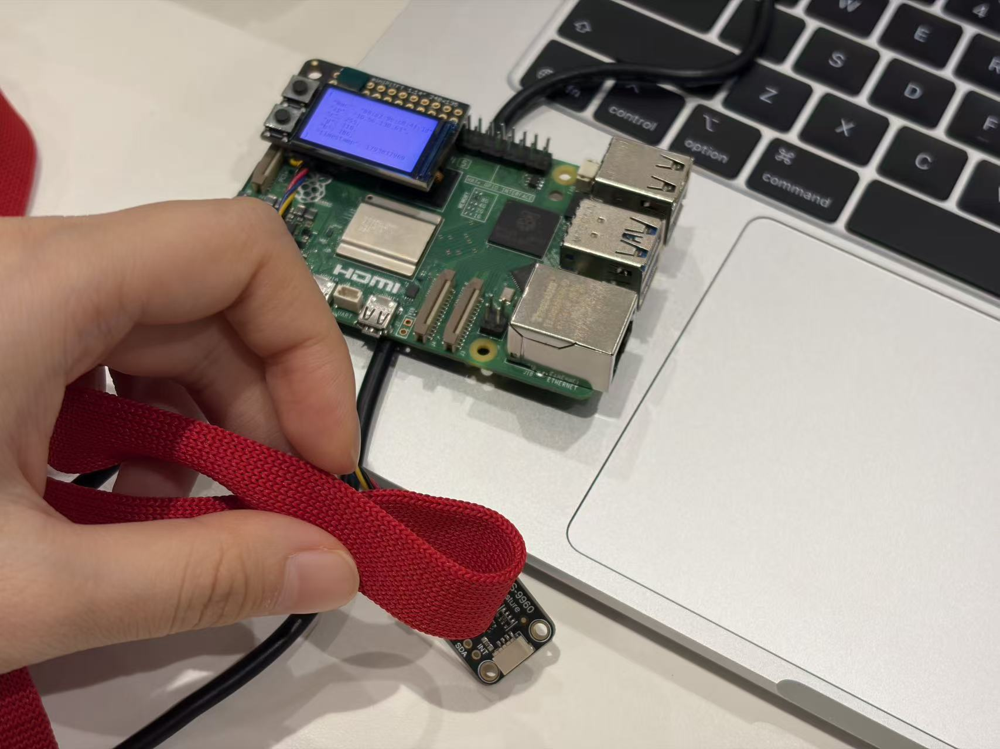
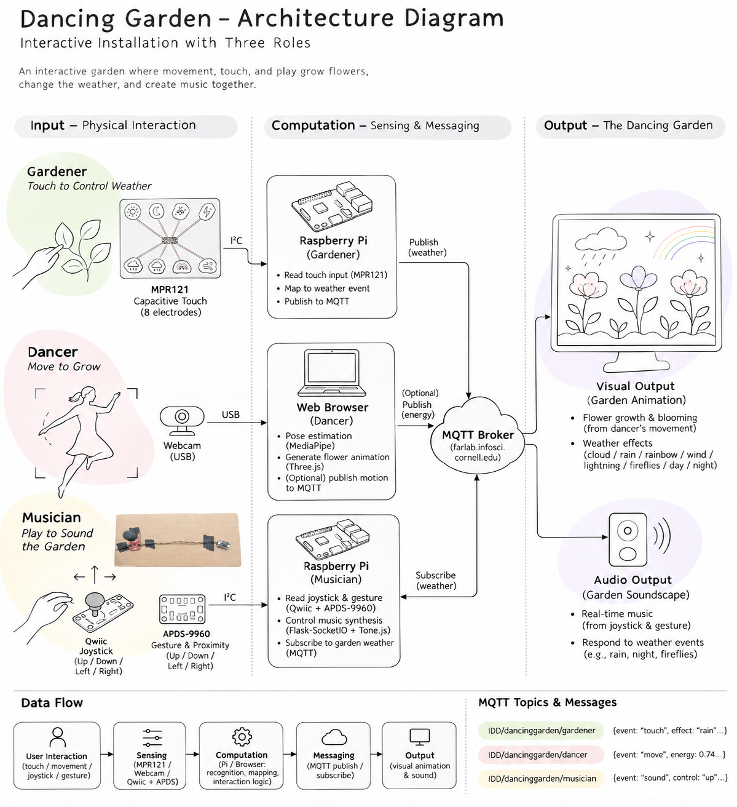
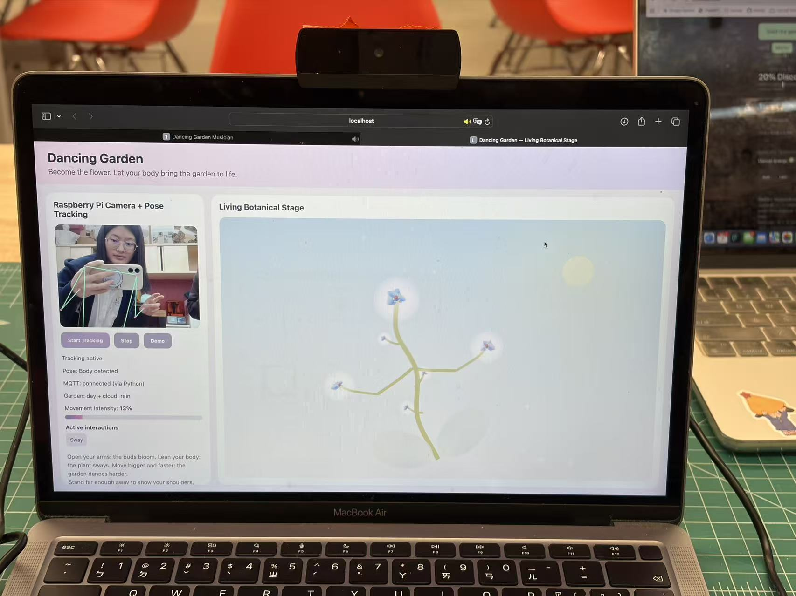
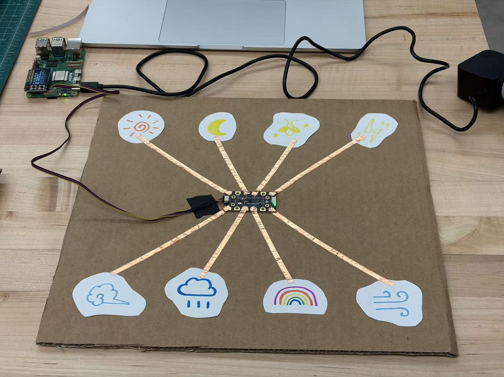
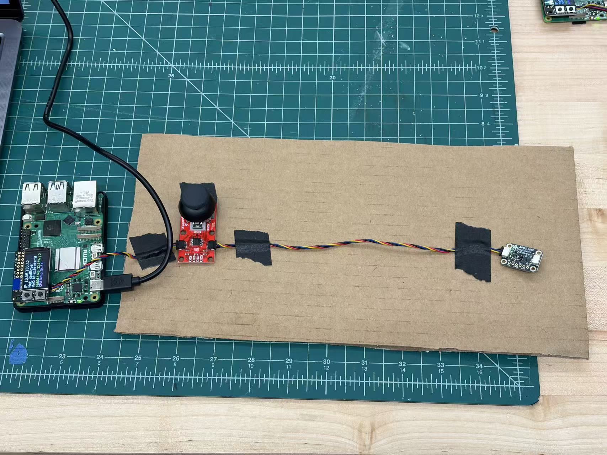
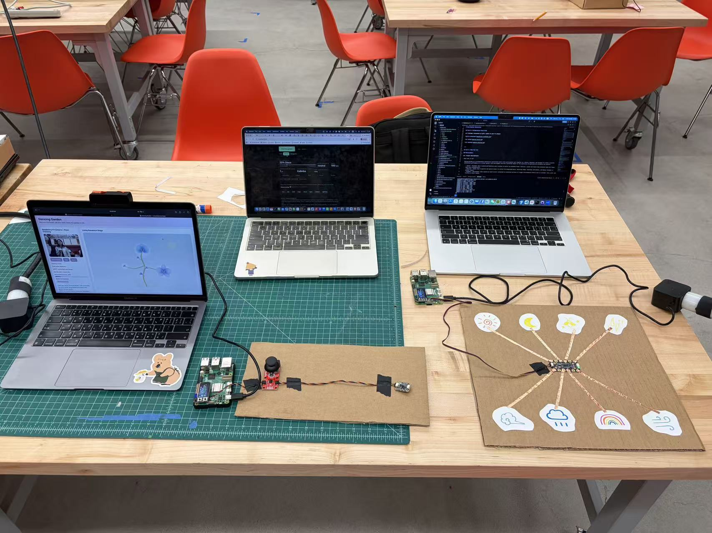

# Distributed Interaction

**NAMES OF COLLABORATORS HERE**

Jianing Li (jl4837)

Aurora Jiaxin Shen (js3996)

Regina Chang (tc845)

---

## Overview

This lab explores distributed interaction: multiple devices sense different kinds of input, exchange messages over a network, and contribute to a shared experience. We first explored MQTT messaging and a collaborative pixel-grid example, then built Dancing Garden, a three-person interactive audiovisual installation.

---

## Part A: MQTT Messaging

**💡 Brainstorm 5 ideas for messaging between devices**

MQTT agrees on almost nothing in advance: you invent the topics and what the messages mean. Smart-home standards like Matter fix the vocabulary instead (every "light" behaves the same). Keep this trade-off in mind when you design your topics in Part C.

- 1. **Distant Dining Companion**

Inspired by our previous *Distant Dining Companion* concept, this system connects two people dining in different locations. When a sensor detects someone sitting down at one dining table, the other person's device responds by lighting up LEDs, rotating a flower, or playing music, creating a sense of shared presence despite the physical distance.

- 2. **Cooperative Trust Game**

Three players collaboratively control a virtual plate suspended by three ropes, each pulled by a character from a different direction. Using joysticks or rotary encoders, players must coordinate their movements to guide a ball on the plate into a cup at a designated location on the screen. Obstacles along the way may break the ropes, requiring careful communication and teamwork.

- 3. **Collaborative Music Creation**

Three players use different sensors to create music together. One controls melody and pitch using a joystick, another adjusts volume or sound effects through a gesture sensor, and the third creates rhythms using physical buttons. Their inputs are synchronized through MQTT to produce a shared musical performance.

- 4. **Symbiotic Garden**

Three players collaboratively nurture a virtual garden by controlling different environmental elements. One uses a rotary encoder to adjust sunlight intensity, another uses a proximity sensor to control rainfall, and the third uses a joystick to control wind direction and strength. Their combined inputs influence how virtual flowers grow, move, and bloom.

- 5. **Collaborative Dancing**

Three players jointly control a dancing virtual character. One selects and adjusts the background music using buttons or a rotary encoder, while the other two control the character's arms and legs through hand and body movements detected by MediaPipe. The system combines their inputs to generate a coordinated dance performance in real time.


---

## Part B: Collaborative Pixel Grid

**📸 Include: Screenshot of grid + photo of your Pi setup**








---

## Part C: Make Your Own

### Deliverables

#### **1. Project Description**

- What does it do? 

   Dancing Garden is a collaborative interactive installation where three participants work together as a Dancer, Musician, and Gardener to create a playful audiovisual performance in a virtual garden. Each participant controls a different aspect of the experience through physical movements and sensors:

      - **Dancer — Movement**: Uses a webcam and MediaPipe pose tracking to control an animated flower character. Larger and faster body movements make the flower dance more energetically.
      - **Musician — Sound**: Uses a joystick and gesture sensor to control the background music, adjusting tempo, switching instruments, and adding rhythmic or melodic layers.
      - **Gardener — Environment**: Uses capacitive touch sensors connected to conductive surfaces to trigger environmental effects such as sunlight, rain, wind, and firefly or insect sounds.

   The three roles run as separate components and use MQTT to exchange events. The Dancer's browser provides the main visual stage, while the Musician's browser handles sound. Our final demonstration shows the roles being performed together as a shared audiovisual experience.

- Why interesting? 

   Dancing Garden combines collaborative dancing, music-making, and interactive gardening into one shared performance. The three roles are interconnected: music influences the garden's visual rhythm, weather changes the atmosphere of the dance, and the dancer's movements bring the flowers to life.

   No single participant controls the entire experience. Instead, the performance emerges from their coordination and improvisation. When all three participants synchronize their actions, they can trigger a special Collective Bloom Moment, transforming the garden into a vibrant celebration of music, movement, and nature.

- User experience?

   Three participants gather around the installation, each taking one role. The Dancer moves in front of the camera, the Musician experiments with the joystick and hand gestures, and the Gardener touches conductive pads to change the environment. Their actions immediately influence the same virtual garden.

   As participants explore how their actions affect one another, they can communicate, experiment, and coordinate to create a unique performance together. The goal is to encourage playful collaboration, embodied interaction, and a sense of shared agency through distributed physical interfaces.


#### **2. Architecture Diagram**
- Hardware, connections, data flow
- Label input/computation/output



The implementation separates input, computation, communication, and output:

| Role | Input hardware | Local processing | Network / output |
| --- | --- | --- | --- |
| Dancer | Camera | Camera snapshot service; MediaPipe pose analysis in the browser; mapping pose features to animation | Three.js flower on the shared screen; Python MQTT bridge receives other roles' events |
| Gardener | Conductive touch pads + MPR121 over I²C | Raspberry Pi detects new touch edges and debounces input | Publishes JSON touch events over MQTT; `weather.js` renders weather in the Dancer page |
| Musician | Qwiic joystick + APDS-9960 gesture/proximity sensor | Raspberry Pi reads sensors; Flask-SocketIO forwards events; browser runs Tone.js synthesis | Music is played through the Musician browser; its server publishes music-related MQTT messages |


#### **3. Build Documentation**
- Photos of each Pi + sensors

| Component | Hardware and interaction | Photo |
| --- | --- | --- |
| Dancer | Camera-based full-body interaction, displayed as a responsive animated flower |  |
| Gardener | Cardboard interface with conductive touch areas connected to an MPR121 sensor and Raspberry Pi |  |
| Musician | Raspberry Pi with Qwiic joystick and APDS-9960 gesture/proximity sensor |  |

**[Watch Gardener close-up](imgs/final_gardener.mp4)** — Physical touch interaction and its environmental feedback.

**[Watch Musician close-up](imgs/final_musician.mp4)** — Joystick and gesture-based musical interaction.

- MQTT topics used

| Topic in current code | Publisher / subscriber | Meaning |
| --- | --- | --- |
| `IDD/dancinggarden/gardener` | Gardener Pi → Dancer camera server | JSON capacitive-touch event; changes weather in the shared visual stage |
| `IDD/dancinggarden/music/beat` | Musician server publishes | Musical beat event |
| `IDD/dancinggarden/music/bpm` | Musician server publishes | Current tempo |
| `IDD/dancinggarden/music/energy` | Musician server publishes | Music intensity / layer level |
| `IDD/dancinggarden/music/instrument` | Musician server publishes | Selected instrument |
| `IDD/dancinggarden/dancer/energy` | Musician server subscribes | Intended Dancer movement-energy input |
| `IDD/dancinggarden/garden/weather` | Musician server subscribes | Intended weather input for musical response |

- Code snippets with explanations

**Dancer:** [`dancer/index.html`](dancer/index.html) implements the browser interface, MediaPipe pose estimation, and Three.js flower animation. [`dancer/camera_server.py`](dancer/camera_server.py) serves the page, proxies camera snapshots, and makes subscribed MQTT events available through `/mqtt-events`.

**Gardener:** [`gardener/gardener_mqtt.py`](gardener/gardener_mqtt.py) reads the MPR121 via I²C, detects a new press, and publishes a compact JSON message. [`dancer/weather.js`](dancer/weather.js) draws a responsive Canvas overlay for the weather. The earlier standalone [`gardener/garden_background.py`](gardener/garden_background.py) documents our initial Pygame-based visualization; the integrated browser version uses `weather.js` instead.

**Musician:** [`musician/musician_server.py`](musician/musician_server.py) reads the joystick and APDS-9960 and forwards input to the browser through Flask-SocketIO. [`musician/index.html`](musician/index.html) uses Tone.js to generate and control music.

**Integration note:** The Dancer page currently listens for music feedback under `garden/musician/beat` and `garden/musician/state`, while the Musician publishes under `IDD/dancinggarden/music/...`. Similarly, the Gardener's actual touch-event topic differs from the weather topic expected by the Musician. These paths are not automatically interchangeable. Therefore, the code clearly demonstrates Gardener-to-Dancer weather control and an independently operating music interface, but some proposed cross-role musical feedback still requires topic/payload alignment. We document this explicitly rather than claiming that every planned link was verified.

A Gardener touch event has the following structure:

```json
{
  "device": "gardener",
  "event": "touch",
  "electrode": 2,
  "effect": "rain"
}
```

The MPR121 electrodes are mapped as follows:

| Electrode | Effect | Interaction |
| --- | --- | --- |
| 0 | Cloud | Toggle |
| 2 | Rain | Toggle |
| 3 | Rainbow | Toggle |
| 5 | Wind | Toggle |
| 6 | Lightning | Toggle |
| 8 | Fireflies | Toggle |
| 9 | Night | Select night |
| 11 | Day | Select day |

**Event processing example:** The Gardener code compares the current electrode reading with its previous state, sends an event only when a new press begins, and uses a 250 ms debounce interval to reduce accidental repeats. The browser maps that event to a weather flag. Thus, touching the rain pad once turns rain on; touching it again turns rain off. The interface also offers keyboard controls for debugging without the physical hardware.

```python
# Simplified from gardener/gardener_mqtt.py
if pressed and not previous[pin] and now - last_touch[pin] > .25:
    payload = {
        'device': 'gardener',
        'event': 'touch',
        'electrode': pin,
        'effect': effect
    }
    client.publish(TOPIC, json.dumps(payload), qos=0)
```

The Gardener's integrated visualization uses relative coordinates and a `ResizeObserver` so the weather canvas can follow the dimensions of the main garden display. This replaced the earlier separate Pygame output and reduced the need to synchronize two independent graphical windows.


#### **4. User Testing**
- **Test with 2+ people NOT on your team**

We tested the installation with three people who were not members of our team. Because Dancing Garden is designed for three simultaneous roles, each participant chose the interaction station they found most interesting before trying the prototype. We observed their first impressions, responses to the feedback, and suggestions for improvement.

- Photos/video of use

**Testing documentation:** [Three-person interaction](imgs/final_interaction.mp4) · [Gardener close-up](imgs/final_gardener.mp4) · [Musician close-up](imgs/final_musician.mp4) · [Final shared screen](imgs/final_screen.mp4)

- What did they think before trying?
- What surprised them?
- What would they change?

| Question | Observation / feedback | Design implication |
| --- | --- | --- |
| **What did they think before trying?** | The installation looked interesting and inviting. Participants selected different stations according to their interests. | Distinct physical interfaces help people approach the installation and choose how to participate. |
| **What surprised them?** | The immediate, tangible connection between an action and a visual or audible response was especially engaging. | Clear feedback makes the distributed system feel responsive and playful. |
| **What would they change?** | Participants suggested using a larger display, expressed interest in swapping roles to try the other inputs, and wanted a richer garden scene. | The shared output needs stronger visual presence; role switching and more expressive content could extend engagement. |


#### **5. Reflection**
- What worked well?

The strongest part of Dancing Garden was the **immediacy of its feedback**. Body movement changed the flower, touch changed the atmosphere, and musical controls changed the sound. The three modes of interaction felt different but belonged to the same playful concept. During testing, participants quickly understood that they could experiment and receive a response, making the experience accessible without extensive instructions.

The modular design also allowed us to build and test the roles in parallel. MQTT provided a useful way to connect hardware-based input with a browser-rendered experience.

- Challenges with distributed interaction?

**Integration and visual consistency.** Each component was initially developed separately. When we brought the parts together, the weather effects and flower scene used different rendering approaches and coordinate systems. We had to adapt visual dimensions and move the weather rendering into the shared browser interface. In hindsight, we should have agreed earlier on a common display resolution, layering rules, color palette, and event schema.

**Shared attention.** The final display was relatively small for three participants. With movement, weather, and music occurring simultaneously, the result could feel visually busy, and people tended to pay the most attention to the part they personally controlled. A more deliberate moment for everyone to stop interacting and view the completed performance would strengthen the sense of co-creation.

**Communication contracts.** MQTT simplified transport but did not guarantee interoperability. Separately implemented components could use different topic names or payload formats for conceptually similar events. The remaining differences between the Musician and Dancer/Gardener topics show why shared message specifications and end-to-end tests are essential.

**Visual legibility.** Some environmental changes were subtle against the pale, pastel garden palette. The final output would benefit from clearer contrast and more differentiated weather states, especially when projected or viewed from a distance.

- How did sensor events work?

The system converted physical actions into discrete events or continuous control values, depending on the sensor:

- **Gardener:** The MPR121 reported capacitive touches. The Raspberry Pi detected press transitions, applied debounce logic, and published MQTT JSON events. The Dancer browser received these through the Python bridge and updated its weather state.
- **Dancer:** The camera supplied image frames to MediaPipe in the browser. Pose landmarks were transformed into measures such as arm openness, body lean, and wrist movement speed. These continuously drove the flower animation, with smoothing to make movement look natural.
- **Musician:** Joystick and APDS-9960 readings were processed on the Raspberry Pi and forwarded to the browser via Socket.IO. The browser interpreted them as musical controls and scheduled sound with Tone.js. The Musician server also published music-related MQTT events for possible use by other components.

This separation let each input be processed near the hardware or the interface best suited to it, while the network carried compact control messages rather than raw sensor streams or video.

- What would you improve?

1. **Make the shared artwork larger.** Project the garden onto a wall or use a large display so that all three participants can see and appreciate the same evolving scene.
2. **Add a “record, replay, appreciate” moment.** Let the system capture a short collaborative performance and replay it after participants finish. This could shift attention from individual control toward a shared creative achievement.
3. **Make the garden more expressive.** Add richer plants, stronger color contrast, distinct transitions between weather states, and visual reactions that combine inputs rather than simply overlaying separate effects.
4. **Deepen cross-role influence.** Let movement intensity affect musical energy, let weather change musical texture, and let beats visibly pulse through the garden—using one agreed-upon MQTT schema and verified subscriptions.
5. **Support role switching.** Encourage participants to exchange stations after a short round so they can experience how each input contributes to the whole.
6. **Standardize earlier.** Define display dimensions, layer order, topic conventions, payload types, and a shared integration test before implementing the separate modules.

Ultimately, we see Dancing Garden as the beginning of a **participatory art installation**. Its potential lies not only in making sensors work together, but in helping people feel that they have created something together.

- Where did computation happen in your system, and why there? (If you used a language model: did it run on every event, or only at setup?)

| Location | Computation | Reason |
| --- | --- | --- |
| Gardener Raspberry Pi | I²C sensor reading, touch-edge detection, debounce, MQTT publishing | Low-cost local filtering prevents repeated or unnecessary network messages. |
| Dancer camera service | Snapshot proxy and MQTT-to-HTTP event bridge | Makes camera frames and incoming events available to the main browser interface. |
| Dancer browser | MediaPipe inference, pose-to-motion mapping, Three.js animation, Canvas weather rendering | Keeps visual updates and pose-responsive animation close to the display. |
| Musician Raspberry Pi | Joystick and APDS-9960 reading, local event forwarding, MQTT publishing | Interfaces directly with the physical sensors. |
| Musician browser | Tone.js synthesis, sequencing, and audio feedback | Enables responsive, flexible sound generation. |
| MQTT broker | Routing published messages to subscribers | Decouples the devices and allows independent development. |

---

## Project Files

- [`dancer/`](dancer/) — Camera-based pose tracking, Three.js garden, main display, MQTT event bridge, and responsive weather overlay.
- [`gardener/`](gardener/) — MPR121 touch input and initial environment visualization prototype.
- [`musician/`](musician/) — Joystick and gesture sensing, Socket.IO server, and Tone.js music interface.
- [`imgs/`](imgs/) — Prototype photos, architecture diagram, and demonstration videos.

## Media Gallery

| Final system | Individual stations |
| --- | --- |
|  |  |
|  |  |

- [Final audiovisual screen recording](imgs/final_screen.mp4)
- [Three-person interaction and user testing](imgs/final_interaction.mp4)
- [Gardener interaction close-up](imgs/final_gardener.mp4)
- [Musician interaction close-up](imgs/final_musician.mp4)
